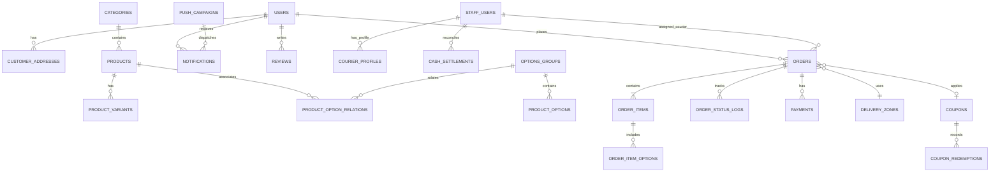

# Arwaq Al Enab — Backend Engineering Specification

**Project:** Arwaq Al Enab restaurant and food delivery application  
**Location:** Tabuk, Saudi Arabia  
**Client applications:** Customer App and Manager/Admin/Cashier App  
**Backend stack:** Laravel REST API (PHP 8.2+), MySQL 8.0+, Redis, Firebase Cloud Messaging (FCM), approved Saudi payment gateways (Mada, Apple Pay, and credit cards).

> **Localization rule:** The customer app currently displays Arabic only. Store Arabic and English text in separate fields for translatable entities. Arabic content is required where the current UI depends on it; English translations may be `NULL` until English UI/content is introduced. Keep field names explicit (`name_ar`, `name_en`, `description_ar`, `description_en`). Do not store both languages in one column.

---

## 1. System Architecture

Use a modular monolithic Laravel REST API connected to MySQL. Keep business logic for orders, pricing, offers, coupons, couriers, and restaurant operations organized in suitable service/action classes when complexity justifies them.

Use Redis for caching and queues where configured. Queued work may include notifications, OTP/SMS delivery, and printing tasks.

### Main components

1. **API routing**
   - Customer endpoints: `/api/v1/customer/...`
   - Management and cashier endpoints: `/api/v1/admin/...`
   - Payment webhooks: `/api/v1/webhooks/...`

2. **Authentication and authorization**
   - Customers: Saudi phone number and SMS OTP.
   - Managers and cashiers: username/email and password, with a PIN/second factor only if the approved authentication design requires it.
   - Use Laravel Sanctum for API authentication unless the existing project architecture explicitly establishes otherwise.
   - Use role-based authorization for owner, administrator, cashier, dispatcher, and courier permissions.

3. **Real-time updates**
   - Firebase Cloud Messaging (FCM) for push notifications.
   - Laravel Reverb or Pusher for WebSocket updates if real-time order tracking is implemented.

Do not add infrastructure or third-party services until their need and configuration are confirmed.

---

## 2. Database ERD and Schema

The following is the proposed domain schema. Inspect the existing migrations and models before implementing it. Do not create duplicate tables if equivalent entities already exist.

### 2.1 Entity relationships



This ERD is a conceptual reference. Verify every relationship against the final schema. Add missing entities only when they are required by the approved design.

### 2.2 Users and authentication

#### `users` — customers

- `id`: BIGINT UNSIGNED, primary key.
- `phone`: VARCHAR(20), unique, required.
- `full_name`: VARCHAR(100), nullable.
- `email`: VARCHAR(120), nullable, unique where supported by the chosen database behavior.
- `preferred_language`: ENUM(`ar`, `en`), default `ar`.
- `is_vip`: BOOLEAN, default `false`.
- `total_orders_count`: unsigned integer, default `0`.
- `total_spent_amount`: DECIMAL(10,2), default `0.00`.
- `last_order_at`: TIMESTAMP, nullable.
- `status`: ENUM(`active`, `blocked`), default `active`.
- `created_at`, `updated_at`.

Use the standard Laravel password/token conventions where applicable. OTP secrets and verification state should be stored securely and should never be returned in API responses.

#### `customer_addresses`

- `id`: BIGINT UNSIGNED, primary key.
- `user_id`: foreign key to `users.id`, cascade on delete where appropriate.
- `title_ar`: VARCHAR(50), required for Arabic UI.
- `title_en`: VARCHAR(50), nullable.
- `city_ar`: VARCHAR(50), default value may be configured as Tabuk in Arabic.
- `city_en`: VARCHAR(50), nullable.
- `district_ar`: VARCHAR(100), required.
- `district_en`: VARCHAR(100), nullable.
- `street_details_ar`: VARCHAR(255), nullable.
- `street_details_en`: VARCHAR(255), nullable.
- `latitude`: DECIMAL(10,8), nullable.
- `longitude`: DECIMAL(11,8), nullable.
- `notes`: TEXT, nullable.
- `is_default`: BOOLEAN, default `false`.
- `created_at`, `updated_at`.

Address fields that are free-form user input do not necessarily need translation pairs. Use localized pairs for predefined labels/locations that the application manages; retain customer-entered notes as entered by the customer.

#### `staff_users` — management, cashiers, dispatchers, and couriers

- `id`: BIGINT UNSIGNED, primary key.
- `username`: VARCHAR(50), unique, required.
- `email`: VARCHAR(120), unique, required.
- `password_hash`: VARCHAR(255), required, or use Laravel's conventional `password` field if using the standard authenticatable model.
- `pin_code_hash`: VARCHAR(255), nullable.
- `role`: ENUM(`super_admin`, `cashier`, `dispatcher`, `courier`), required.
- `full_name`: VARCHAR(100), required.
- `phone`: VARCHAR(20), required.
- `is_active`: BOOLEAN, default `true`.
- `created_at`, `updated_at`.

#### `courier_profiles`

- `id`: BIGINT UNSIGNED, primary key.
- `staff_user_id`: unique foreign key to `staff_users.id`.
- `vehicle_type_ar`: VARCHAR(50), nullable.
- `vehicle_type_en`: VARCHAR(50), nullable.
- `plate_number`: VARCHAR(20), nullable.
- `current_status`: ENUM(`available`, `delivering`, `break`, `offline`), default `available`.
- `active_orders_count`: integer, default `0`.
- `rating_avg`: DECIMAL(2,1), default `5.0`.
- `current_cash_held`: DECIMAL(10,2), default `0.00`.
- `current_lat`: DECIMAL(10,8), nullable.
- `current_lng`: DECIMAL(11,8), nullable.
- `updated_at`.

### 2.3 Menu, products, and options

#### `categories`

- `id`: INT UNSIGNED, primary key.
- `name_ar`: VARCHAR(100), required.
- `name_en`: VARCHAR(100), nullable until English content is available.
- `slug`: VARCHAR(100), unique, required.
- `sort_order`: integer, default `0`.
- `is_active`: BOOLEAN, default `true`.
- `created_at`, `updated_at`.

#### `products`

- `id`: BIGINT UNSIGNED, primary key.
- `category_id`: foreign key to `categories.id`.
- `name_ar`: VARCHAR(150), required.
- `name_en`: VARCHAR(150), nullable until English content is available.
- `description_ar`: TEXT, nullable.
- `description_en`: TEXT, nullable.
- `image_url`: VARCHAR(255), nullable, or use the existing media-storage strategy.
- `base_price`: DECIMAL(8,2), required, default `0.00` only if zero-priced products are valid.
- `has_discount`: BOOLEAN, default `false`.
- `discount_percentage`: DECIMAL(5,2), default `0.00`.
- `discounted_price`: calculate consistently in the application or use a generated column only if supported by the database and existing design.
- `is_available`: BOOLEAN, default `true`.
- `sort_order`: integer, default `0`.
- `created_at`, `updated_at`.

**Localization rule:** Every product must have an Arabic name. `name_en` is included in the schema but can remain `NULL` while the app is Arabic-only. Product descriptions in both languages are nullable.

#### `product_variants`

- `id`: BIGINT UNSIGNED, primary key.
- `product_id`: foreign key to `products.id`, cascade on delete where appropriate.
- `size_key`: ENUM(`small`, `medium`, `large`, `jumbo`, `family`), required.
- `name_ar`: VARCHAR(50), required.
- `name_en`: VARCHAR(50), nullable.
- `piece_count`: unsigned integer, required.
- `portion_description_ar`: VARCHAR(100), nullable.
- `portion_description_en`: VARCHAR(100), nullable.
- `price`: DECIMAL(8,2), required.
- `is_default`: BOOLEAN, default `false`.
- `created_at`, `updated_at`.

#### `options_groups`

- `id`: BIGINT UNSIGNED, primary key.
- `name_ar`: VARCHAR(100), required.
- `name_en`: VARCHAR(100), nullable.
- `type`: ENUM(`single`, `multiple`), required.
- `is_required`: BOOLEAN, default `false`.
- `created_at`, `updated_at`.

#### `product_options`

- `id`: BIGINT UNSIGNED, primary key.
- `group_id`: foreign key to `options_groups.id`.
- `name_ar`: VARCHAR(100), required.
- `name_en`: VARCHAR(100), nullable.
- `description_ar`: TEXT, nullable.
- `description_en`: TEXT, nullable.
- `price`: DECIMAL(6,2), default `0.00`.
- `is_available`: BOOLEAN, default `true`.
- `created_at`, `updated_at`.

Use a pivot/relationship table such as `product_option_relations` if products can be assigned to option groups in a many-to-many relationship. Confirm the relationship cardinality before implementation.

### 2.4 Orders and financial processing

#### `orders`

- `id`: BIGINT UNSIGNED, primary key.
- `order_number`: VARCHAR(30), unique, required.
- `user_id`: foreign key to `users.id`.
- `customer_name`: VARCHAR(100), required snapshot.
- `customer_phone`: VARCHAR(20), required snapshot.
- `delivery_address_id`: nullable foreign key to `customer_addresses.id` when pickup is supported.
- `delivery_zone_id`: nullable foreign key to `delivery_zones.id` when not applicable.
- `courier_id`: nullable foreign key to `staff_users.id`.
- `order_status`: use the approved lifecycle; proposed values:
  `pending_confirmation`, `preparing_in_kitchen`, `ready_for_pickup`, `out_for_delivery`, `delivered`, `cancelled`, `rejected`.
- `payment_method`: use the approved values, such as `cash_on_delivery`, `credit_card`, `mada`, `apple_pay`.
- `payment_status`: proposed values `pending`, `paid`, `cash_collected_by_courier`, `reconciled`, `failed`, `refunded`.
- `subtotal_amount`: DECIMAL(10,2), required.
- `product_discount_amount`: DECIMAL(10,2), default `0.00`.
- `coupon_id`: nullable foreign key to `coupons.id`.
- `coupon_discount_amount`: DECIMAL(10,2), default `0.00`.
- `delivery_fee`: DECIMAL(8,2), default should be determined by business rules.
- `vat_tax_amount`: DECIMAL(8,2), default `0.00`.
- `total_final_amount`: DECIMAL(10,2), required.
- `chef_special_notes`: TEXT, nullable.
- `estimated_prep_time_minutes`: integer, default `30`.
- `dispatched_at`: TIMESTAMP, nullable.
- `delivered_at`: TIMESTAMP, nullable.
- `created_at`, `updated_at`.

Store an order's currency and purchase-time amounts consistently. Confirm tax-inclusive/exclusive behavior and delivery-fee rules before implementation.

#### `order_items`

- `id`: BIGINT UNSIGNED, primary key.
- `order_id`: foreign key to `orders.id`, cascade on delete only if consistent with retention requirements.
- `product_id`: foreign key to `products.id`, with an appropriate deletion strategy.
- `variant_id`: nullable or required according to whether every product has variants.
- `product_name_ar_snapshot`: VARCHAR(150), required.
- `product_name_en_snapshot`: VARCHAR(150), nullable.
- `size_name_ar_snapshot`: VARCHAR(50), required where variants are used.
- `size_name_en_snapshot`: VARCHAR(50), nullable.
- `piece_count_snapshot`: integer, required where applicable.
- `unit_price`: DECIMAL(8,2), required.
- `quantity`: unsigned integer, default `1`.
- `line_total`: DECIMAL(10,2), required.
- `created_at`, `updated_at`.

Store snapshot values so historical orders remain accurate after product details or prices change.

#### `order_item_options`

Store each selected option against its order item, including the option reference where retained, Arabic name snapshot, nullable English name snapshot, and purchase-time price. Use explicit columns rather than relying only on an opaque JSON field when querying or reporting individual options is required.

#### `order_status_logs`

- `id`: BIGINT UNSIGNED, primary key.
- `order_id`: foreign key to `orders.id`.
- `from_status`: VARCHAR(50), nullable.
- `to_status`: VARCHAR(50), required.
- `action_by_staff_id`: nullable foreign key to `staff_users.id`.
- `notes`: VARCHAR(255), nullable.
- `created_at`: timestamp.

#### `payments`

Record payment attempts and provider references separately when needed. Include order reference, provider, amount, currency, status, provider transaction ID, idempotency/reference key, and timestamps. Never store raw card details.

#### `cash_settlements`

- `id`: BIGINT UNSIGNED, primary key.
- `courier_id`: foreign key to `staff_users.id`.
- `reconciled_by_staff_id`: foreign key to `staff_users.id`.
- `amount_collected`: DECIMAL(10,2), required.
- `orders_count`: integer, required.
- `notes`: VARCHAR(255), nullable.
- `settled_at`: timestamp.

### 2.5 Operations, delivery zones, and promotions

#### `store_operations`

- `id`: INT UNSIGNED, primary key.
- `is_store_open_now`: BOOLEAN, default `true`.
- `emergency_pause_until`: TIMESTAMP, nullable.
- `hourly_order_cap`: integer, default `18`.
- `default_prep_time_minutes`: integer, default `30`.
- `rush_hour_buffer_minutes`: integer, default `15`.
- `weekly_schedule_json`: JSON, required.
- `holidays_closures_json`: JSON, nullable.
- `updated_at`.

#### `delivery_zones`

- `id`: INT UNSIGNED, primary key.
- `zone_name_ar`: VARCHAR(100), required.
- `zone_name_en`: VARCHAR(100), nullable.
- `delivery_fee`: DECIMAL(6,2), required.
- `minimum_order_amount`: DECIMAL(8,2), required.
- `is_active`: BOOLEAN, default `true`.
- `created_at`, `updated_at`.

#### `coupons`

- `id`: BIGINT UNSIGNED, primary key.
- `code`: VARCHAR(30), unique, required.
- `discount_type`: ENUM(`percentage`, `fixed_amount`), required.
- `discount_value`: DECIMAL(8,2), required.
- `min_order_value`: DECIMAL(8,2), default `0.00`.
- `allow_combine_with_product_discount`: BOOLEAN, default `false`.
- `start_date`, `end_date`: dates, required.
- `usage_limit_total`: integer, nullable.
- `usage_limit_per_user`: integer, default `1`.
- `is_active`: BOOLEAN, default `true`.
- `created_at`, `updated_at`.

#### `coupon_redemptions`

Track coupon use by order and customer so total and per-customer usage limits can be enforced safely.

#### `push_campaigns`

- `id`: BIGINT UNSIGNED, primary key.
- `title_ar`: VARCHAR(150), required.
- `title_en`: VARCHAR(150), nullable.
- `message_ar`: TEXT, required.
- `message_en`: TEXT, nullable.
- `target_segment`: ENUM(`all_users`, `vip_users`, `inactive_users`, `by_district`), required.
- `deep_link_type`: ENUM(`product`, `category`, `offers_page`, `home`), required.
- `target_item_id`: BIGINT UNSIGNED, nullable.
- `attached_coupon_code`: VARCHAR(30), nullable.
- `scheduled_at`: TIMESTAMP, nullable.
- `sent_at`: TIMESTAMP, nullable.
- `estimated_reach_count`: integer, default `0`.
- `opened_count`: integer, default `0`.
- `direct_orders_count`: integer, default `0`.
- `generated_revenue`: DECIMAL(10,2), default `0.00`.

Use a `notifications` table or the application's established notification system to track delivery and user-specific notification state.

---

## 3. API Specifications

These endpoints describe the intended API surface, not proof that the endpoints already exist. Inspect current routes before creating or changing them. Keep response formats consistent across endpoints.

### 3.1 Customer APIs

#### Authentication and profile

- `POST /api/v1/customer/auth/send-otp`
  - Send a four-digit OTP to a validated Saudi phone number.
  - Example request: `{ "phone": "0530697231" }`
  - Example response: `{ "success": true, "message": "Verification code sent successfully.", "retry_in_seconds": 60 }`
  - Apply rate limiting, expiration, and secure OTP handling.

- `POST /api/v1/customer/auth/verify-otp`
  - Verify the OTP and issue a Sanctum token after successful verification.
  - Example request: `{ "phone": "0530697231", "otp": "4892", "device_fcm_token": "fcm_token_example" }`
  - Example response: `{ "token": "1|example-token", "user": { "id": 1, "full_name": "Customer", "phone": "0530697231", "is_vip": true } }`
  - Return the token securely; never hard-code example credentials or return real tokens in logs.

- `GET /api/v1/customer/profile`
- `PUT /api/v1/customer/profile`
  - Retrieve and update the authenticated customer's profile, including preferred language.

- `GET|POST|PUT|DELETE /api/v1/customer/addresses`
  - List, create, update, and delete the authenticated customer's addresses.

#### Menu and products

- `GET /api/v1/customer/menu`
  - Return active categories and available products, variants, prices, and discounts.
  - Include Arabic fields and English fields when available. The Arabic-only UI should use Arabic values; do not require English translations to display the menu.

- `GET /api/v1/customer/products/{id}`
  - Return product details, variants, option groups, and available add-ons.

#### Cart, checkout, and orders

- `POST /api/v1/customer/checkout/validate-quote`
  - Recalculate prices, validate availability, check store status and delivery-zone rules, and validate a coupon.
  - Example request:
    `{ "district": "Al Muruj", "items": [{ "product_id": 1, "variant_id": 3, "quantity": 1 }], "coupon_code": "WELCOME20" }`

- `POST /api/v1/customer/orders`
  - Validate and create an order, including purchase-time price and product snapshots.
  - Example request:
    ```json
    {
      "address_id": 4,
      "payment_method": "credit_card",
      "chef_notes": "Extra pomegranate molasses; lemon on the side",
      "coupon_code": "WELCOME20",
      "items": [
        { "product_id": 1, "variant_id": 3, "quantity": 1, "options": [2] }
      ]
    }
    ```
  - The backend must calculate totals and verify all prices and discounts.

- `GET /api/v1/customer/orders`
  - Return the authenticated customer's current and previous orders. Support reorder functionality only after revalidating current availability and pricing.

- `GET /api/v1/customer/orders/{order_number}`
  - Return order details, current status, available tracking information, courier details where appropriate, and invoice information when implemented.
  - Enforce order ownership.

### 3.2 Manager/Admin APIs

#### Authentication and order operations

- `POST /api/v1/admin/auth/login`
  - Authenticate authorized management staff. Apply the configured password and additional PIN/second-factor policy.

- `GET /api/v1/admin/orders`
  - List orders with filters for status, payment method/status, and order number.

- `PUT /api/v1/admin/orders/{id}/transition-status`
  - Validate allowed status transitions, update the order atomically, and write to `order_status_logs`.
  - Example request: `{ "to_status": "ready_for_pickup", "notes": "Packed and ready." }`

- `POST /api/v1/admin/orders/{id}/assign-courier`
  - Assign an eligible courier and update related assignment/status data according to approved rules.
  - Example request: `{ "courier_id": 5 }`

- `POST /api/v1/admin/orders/{id}/print-kds`
  - Trigger kitchen-ticket or delivery-slip printing if a printing integration is configured.

#### Couriers and store operations

- `GET /api/v1/admin/couriers`
  - Return courier status, authorized location data, active orders, and outstanding cash amounts.

- `POST /api/v1/admin/couriers/{id}/reconcile-cash`
  - Record cash received and reconcile courier collections.
  - Example request: `{ "amount_received": 158.00, "notes": "Cash settlement for three orders." }`

- `GET|PUT /api/v1/admin/store-operations/status`
  - Read or update store open/closed status, temporary pauses, order capacity, and estimated preparation time.

- `GET|PUT /api/v1/admin/store-operations/schedules`
  - Read or update weekly opening hours and planned closures.

#### Menu and offers

- `GET|POST|PUT|DELETE /api/v1/admin/categories`
- `GET|POST|PUT|DELETE /api/v1/admin/products`
  - Manage category and product data, bilingual names, descriptions, prices, variants, and option groups.

- `POST /api/v1/admin/products/{id}/toggle-availability`
  - Enable or disable product availability.

- `GET|POST|PUT|DELETE /api/v1/admin/coupons`
  - Manage coupon rules, validity, usage limits, and discount-combination policy.

#### Customers and push campaigns

- `GET /api/v1/admin/customers`
  - Search customer records and view permitted customer statistics.

- `POST /api/v1/admin/notifications/send-campaign`
  - Create or send an immediate/scheduled campaign to an authorized target segment.
  - Example request:
    ```json
    {
      "title_ar": "ورق العنب الطازج جاهز الآن!",
      "title_en": null,
      "message_ar": "استمتع بوجبتك اليوم.",
      "message_en": null,
      "target_segment": "vip_users",
      "deep_link_type": "product",
      "target_item_id": 1,
      "attached_coupon_code": "ENAB20",
      "send_immediately": true
    }
    ```
  - English campaign fields may remain `null` until English content is prepared.

---

## 4. Payments, Webhooks, and Security

### Payment gateway webhooks

- Endpoint pattern: `POST /api/v1/webhooks/payments/{provider}`.
- Verify each provider's documented signature and authentication mechanism. Use HMAC-SHA256 only when required by that provider; do not assume every gateway uses the same signature scheme.
- Make webhook processing idempotent to prevent duplicate payment records or repeated order updates.
- Verify payment amount, currency, order reference, and final status with the provider as required.
- Never mark an order paid based only on a client-side success message.
- Do not store raw card details.

### Cash on delivery (COD)

- Keep payment status pending until the courier confirms collection.
- Record collection using `cash_collected_by_courier`.
- Record reconciliation after the cashier confirms the settlement.
- Preserve an auditable history of collection and reconciliation operations.

### Rate limiting and concurrency

- Apply strict throttling to OTP requests and verification attempts. The initial proposed limit is three attempts per ten minutes; confirm whether this means send attempts, verification attempts, or both.
- Use database transactions and appropriate row locks when creating orders or updating limited-capacity resources.
- Prevent duplicate order/payment processing with idempotency controls where appropriate.
- Enforce the hourly kitchen capacity on the server, not in the client application.

---

## 5. Localization and Language Rules

This project currently displays Arabic only, but the schema should be prepared for English content.

### Required conventions

- Use `_ar` for Arabic text and `_en` for English text.
- For product and category names, use `name_ar` and `name_en`.
- For descriptions, use `description_ar` and `description_en`.
- For localized labels such as category names, variant names, option names, delivery-zone names, and campaign text, use paired fields when these are managed by the application.
- Arabic fields required to render current UI content should be `NOT NULL`.
- English fields may be nullable until English translations are supplied.
- Other descriptive text fields may be nullable if the information is optional.
- Do not make an entire record invalid merely because an English translation is not yet available.
- Do not duplicate fields for data that is not language-dependent, such as prices, IDs, status codes, coordinates, timestamps, and quantities.
- Do not translate customer-entered free-form notes automatically or overwrite their original text.
- API responses should expose both language fields when appropriate; the Arabic-only client should render the Arabic field.
- Keep system identifiers and enum values language-neutral, for example `ready_for_pickup`, and translate their display labels in the client or a dedicated localization layer.
- Store order-time localized snapshots when historical display must remain unchanged after a menu edit.

### Migration guidance

If tables or columns already exist, use new Laravel migrations to add or rename fields safely. Before making English fields nullable or renaming existing Arabic-only columns, inspect the deployed schema and existing data. Do not run destructive migrations or reset the database without explicit approval.

---

## 6. Implementation Rules

- Inspect the existing Laravel application before implementation.
- Use Laravel conventions, Eloquent relationships, Form Requests, API Resources, policies, and transactions where appropriate.
- Use Laravel Sanctum for API authentication.
- Validate all input and authorize every protected operation.
- Keep pricing and order business rules on the backend.
- Preserve existing API contracts unless a change is approved.
- Add migrations instead of rewriting deployed migrations.
- Write tests for important authentication, authorization, pricing, order, and payment behavior.
- Never claim a test passed unless it was run successfully.
- Never execute destructive commands without explicit authorization.
- Document required environment variables without exposing secret values.
- Report changed files, migrations, configuration steps, and tests at the end of each implementation task.

**Core principle:** Preserve data integrity and security, make the smallest correct change, and keep the application ready for future English localization without requiring English content today.
