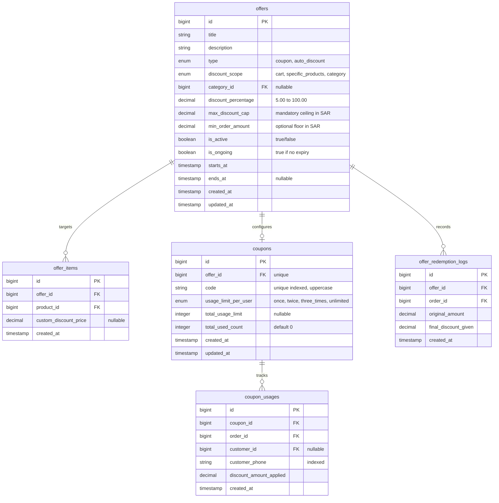

# Offers, Discounts & Coupons Management API Specification

This specification defines the complete backend API, database architecture, and integration requirements for the **Offers & Discounts Management Screen** (`OffersManagementScreen`) and the **Create / Edit Offer Screen** (`AddEditOfferScreen`) in the Arwaq Al-Eneab (أرواق العنب) Manager App.

---

## Table of Contents

1. [Architectural Overview & Business Rules](#1-architectural-overview--business-rules)
2. [Database Schema & ERD Analysis](#2-database-schema--erd-analysis)
    - [2.1 Table: `offers`](#21-table-offers)
    - [2.2 Table: `offer_items`](#22-table-offer_items)
    - [2.3 Table: `coupons`](#23-table-coupons)
    - [2.4 Table: `coupon_usages`](#24-table-coupon_usages)
    - [2.5 Table: `offer_redemption_logs`](#25-table-offer_redemption_logs)
3. [Order Pricing Calculation & Protection Pipeline](#3-order-pricing-calculation--protection-pipeline)
4. [Required API Endpoints Summary](#4-required-api-endpoints-summary)
5. [Endpoint Specifications](#5-endpoint-specifications)
    - [5.1 Get Offers KPI Summary & Statistics](#51-get-offers-kpi-summary--statistics)
    - [5.2 List Offers & Coupons (with Filters)](#52-list-offers--coupons-with-filters)
    - [5.3 Get Single Offer Details](#53-get-single-offer-details)
    - [5.4 Create New Offer / Coupon](#54-create-new-offer--coupon)
    - [5.5 Update Existing Offer](#55-update-existing-offer)
    - [5.6 Toggle Offer Active Status](#56-toggle-offer-active-status)
    - [5.7 Delete / Archive Offer](#57-delete--archive-offer)
    - [5.8 Validate Coupon Code (Customer Checkout API)](#58-validate-coupon-code-customer-checkout-api)
    - [5.9 Menu Items with Strikethrough Pricing API](#59-menu-items-with-strikethrough-pricing-api)
6. [Data Models & Schema Reference](#6-data-models--schema-reference)
    - [6.1 Offer Master Model](#61-offer-master-model)
    - [6.2 Coupon Detail Model](#62-coupon-detail-model)
7. [Error Handling & Error Codes](#7-error-handling--error-codes)

---

## 1. Architectural Overview & Business Rules

The Offers & Discounts system in Arwaq Al-Eneab is built upon two core offer models with strict profit margin protection:

### 1.1 Two Primary Offer Types

- **Type A: Promotional Coupon Code (`coupon`)**:
    - The customer manually enters an alphanumeric promotional code (e.g., `WELCOME20`, `SAVE15`) on the checkout screen.
    - Can have an optional minimum cart order requirement (e.g., min `80.00 SAR`).
    - Constrained by a per-customer usage quota enforced by unique customer phone number (`once`, `twice`, `three_times`, or `unlimited`).
    - Only **one** coupon code can ever be applied per order.
- **Type B: Automatic Menu Item Discount (`auto_discount`)**:
    - Automatically applied in the menu catalog and cart without entering any promotional code.
    - Renders both the original strikethrough price and the discounted price (e.g., `~~40 SAR~~ -> 32 SAR`).
    - Applies to either **specific products** or an **entire food category**.

### 1.2 Strict Financial Margin Protections

1. **Mandatory Maximum Discount Cap (`max_discount_cap`)**:
    - Every offer must have an explicit financial cap (e.g., max `20.00 SAR`).
    - Even on large orders (e.g., `500.00 SAR`), a 20% discount will never exceed `20.00 SAR`.
2. **Coupons Never Stack (Single Coupon Policy)**:
    - Customers cannot combine multiple coupon codes in a single checkout session.
3. **Calculation Priority Pipeline**:
    - Automatic product discounts apply first to establish the item's net selling price.
    - Any cart-level coupon discount is calculated only on the remaining net balance, not on the original gross price.
4. **ZATCA Tax Compliance**:
    - Value Added Tax (15% VAT) is calculated on the net discounted subtotal, ensuring strict compliance with Saudi tax regulations.

---

## 2. Database Schema & ERD Analysis

The backend relational schema requires 5 dedicated tables to manage offers, coupon codes, product bindings, and customer usage histories.



### 2.1 Table: `offers`

Stores master offer records, discount rules, financial ceilings, and validity schedules.

| Column                | Type              | Modifiers                                 | Description                                               |
| :-------------------- | :---------------- | :---------------------------------------- | :-------------------------------------------------------- |
| `id`                  | `BIGINT UNSIGNED` | `AUTO_INCREMENT, PRIMARY KEY`             | Unique offer identifier                                   |
| `title`               | `VARCHAR(255)`    | `NOT NULL`                                | Arabic title displayed to customers and staff             |
| `description`         | `TEXT`            | `NULLABLE`                                | Explanation of discount conditions                        |
| `type`                | `ENUM`            | `'coupon', 'auto_discount'`               | Type of offer mechanism                                   |
| `discount_scope`      | `ENUM`            | `'cart', 'specific_products', 'category'` | Target scope of the discount                              |
| `category_id`         | `BIGINT UNSIGNED` | `NULLABLE, FOREIGN KEY -> categories(id)` | Targeted menu category if scope is category               |
| `discount_percentage` | `DECIMAL(5, 2)`   | `NOT NULL`                                | Discount rate (e.g., `20.00` for 20%)                     |
| `max_discount_cap`    | `DECIMAL(8, 2)`   | `NOT NULL`                                | Maximum allowed discount in SAR (mandatory profit shield) |
| `min_order_amount`    | `DECIMAL(8, 2)`   | `DEFAULT 0.00`                            | Minimum order subtotal required to activate offer         |
| `is_active`           | `BOOLEAN`         | `DEFAULT TRUE`                            | Global kill-switch for the offer                          |
| `is_ongoing`          | `BOOLEAN`         | `DEFAULT TRUE`                            | When true, runs continuously without expiration           |
| `starts_at`           | `TIMESTAMP`       | `NOT NULL`                                | Activation start date and time                            |
| `ends_at`             | `TIMESTAMP`       | `NULLABLE`                                | Expiration date and time (null if ongoing)                |
| `created_at`          | `TIMESTAMP`       | `DEFAULT CURRENT_TIMESTAMP`               | Audit creation timestamp                                  |
| `updated_at`          | `TIMESTAMP`       | `ON UPDATE CURRENT_TIMESTAMP`             | Audit update timestamp                                    |

### 2.2 Table: `offer_items`

Pivot table linking specific menu products to an `auto_discount` offer when `discount_scope = 'specific_products'`.

| Column                  | Type              | Modifiers                                        | Description                                  |
| :---------------------- | :---------------- | :----------------------------------------------- | :------------------------------------------- |
| `id`                    | `BIGINT UNSIGNED` | `AUTO_INCREMENT, PRIMARY KEY`                    | Pivot entry identifier                       |
| `offer_id`              | `BIGINT UNSIGNED` | `NOT NULL, FK -> offers(id) ON DELETE CASCADE`   | Linked offer                                 |
| `product_id`            | `BIGINT UNSIGNED` | `NOT NULL, FK -> products(id) ON DELETE CASCADE` | Discounted menu product                      |
| `custom_discount_price` | `DECIMAL(8, 2)`   | `NULLABLE`                                       | Optional explicit promotional price override |
| `created_at`            | `TIMESTAMP`       | `DEFAULT CURRENT_TIMESTAMP`                      | Creation timestamp                           |

### 2.3 Table: `coupons`

Stores promotional codes and customer usage limits when `type = 'coupon'`.

| Column                 | Type              | Modifiers                                              | Description                             |
| :--------------------- | :---------------- | :----------------------------------------------------- | :-------------------------------------- |
| `id`                   | `BIGINT UNSIGNED` | `AUTO_INCREMENT, PRIMARY KEY`                          | Coupon identifier                       |
| `offer_id`             | `BIGINT UNSIGNED` | `NOT NULL, UNIQUE, FK -> offers(id) ON DELETE CASCADE` | Parent offer definition                 |
| `code`                 | `VARCHAR(32)`     | `NOT NULL, UNIQUE, INDEX`                              | Coupon code (always stored UPPERCASE)   |
| `usage_limit_per_user` | `ENUM`            | `'once', 'twice', 'three_times', 'unlimited'`          | Limit per unique phone number           |
| `total_usage_limit`    | `INT UNSIGNED`    | `NULLABLE`                                             | Optional total store-wide usage ceiling |
| `total_used_count`     | `INT UNSIGNED`    | `DEFAULT 0`                                            | Current aggregate redemption count      |
| `created_at`           | `TIMESTAMP`       | `DEFAULT CURRENT_TIMESTAMP`                            | Creation timestamp                      |
| `updated_at`           | `TIMESTAMP`       | `ON UPDATE CURRENT_TIMESTAMP`                          | Update timestamp                        |

### 2.4 Table: `coupon_usages`

Audit log recording every redemption to enforce usage limits per customer phone number.

| Column                    | Type              | Modifiers                       | Description                        |
| :------------------------ | :---------------- | :------------------------------ | :--------------------------------- |
| `id`                      | `BIGINT UNSIGNED` | `AUTO_INCREMENT, PRIMARY KEY`   | Log identifier                     |
| `coupon_id`               | `BIGINT UNSIGNED` | `NOT NULL, FK -> coupons(id)`   | Redeemed coupon                    |
| `order_id`                | `BIGINT UNSIGNED` | `NOT NULL, FK -> orders(id)`    | Order where coupon was applied     |
| `customer_id`             | `BIGINT UNSIGNED` | `NULLABLE, FK -> customers(id)` | Customer ID if registered account  |
| `customer_phone`          | `VARCHAR(20)`     | `NOT NULL, INDEX`               | Phone number used to verify limits |
| `discount_amount_applied` | `DECIMAL(8, 2)`   | `NOT NULL`                      | Net SAR discount deducted          |
| `created_at`              | `TIMESTAMP`       | `DEFAULT CURRENT_TIMESTAMP`     | Redemption timestamp               |

### 2.5 Table: `offer_redemption_logs`

Financial reconciliation table tracking aggregate savings and ROI per offer campaign.

| Column                 | Type              | Modifiers                     | Description                        |
| :--------------------- | :---------------- | :---------------------------- | :--------------------------------- |
| `id`                   | `BIGINT UNSIGNED` | `AUTO_INCREMENT, PRIMARY KEY` | Audit identifier                   |
| `offer_id`             | `BIGINT UNSIGNED` | `NOT NULL, FK -> offers(id)`  | Target offer                       |
| `order_id`             | `BIGINT UNSIGNED` | `NOT NULL, FK -> orders(id)`  | Affected order                     |
| `original_amount`      | `DECIMAL(8, 2)`   | `NOT NULL`                    | Gross amount before discount       |
| `final_discount_given` | `DECIMAL(8, 2)`   | `NOT NULL`                    | Final amount discounted (post-cap) |
| `created_at`           | `TIMESTAMP`       | `DEFAULT CURRENT_TIMESTAMP`   | Redemption timestamp               |

---

## 3. Order Pricing Calculation & Protection Pipeline

The backend pricing engine must calculate cart totals using the following exact mathematical sequence:

```
[1] Base Menu Items Total:
    gross_items_subtotal = Sum(item.price * item.quantity)

[2] Automatic Item Discounts:
    For each item in cart:
        if item matches active auto_discount offer:
            item_discount = Min(item.price * (offer.discount_percentage / 100), offer.max_discount_cap)
            item.effective_price = item.price - item_discount
    net_items_subtotal = Sum(item.effective_price * item.quantity)
    total_auto_discount = gross_items_subtotal - net_items_subtotal

[3] Coupon Discount (Cart Level):
    if valid coupon provided:
        if net_items_subtotal >= coupon.min_order_amount:
            raw_coupon_discount = net_items_subtotal * (coupon.discount_percentage / 100)
            final_coupon_discount = Min(raw_coupon_discount, coupon.max_discount_cap)
        else:
            final_coupon_discount = 0.00
    else:
        final_coupon_discount = 0.00

[4] Final Net Subtotal:
    discounted_subtotal = net_items_subtotal - final_coupon_discount

[5] Delivery & VAT:
    taxable_amount = discounted_subtotal + delivery_fee
    vat_amount = taxable_amount * 0.15
    grand_total = taxable_amount
```

---

## 4. Required API Endpoints Summary

| Method          | Endpoint                                    | Description                                                         |
| :-------------- | :------------------------------------------ | :------------------------------------------------------------------ |
| `GET`           | `/api/v1/manager/offers/stats`              | KPI summary metrics (active, scheduled, expired counts)             |
| `GET`           | `/api/v1/manager/offers`                    | Filterable list of offers (`all`, `active`, `scheduled`, `expired`) |
| `GET`           | `/api/v1/manager/offers/{id}`               | Full offer details with items and usage statistics                  |
| `POST`          | `/api/v1/manager/offers`                    | Create a new coupon or automatic product discount                   |
| `PUT` / `PATCH` | `/api/v1/manager/offers/{id}`               | Update existing offer configuration and limits                      |
| `PATCH`         | `/api/v1/manager/offers/{id}/toggle-status` | Enable or disable offer active status immediately                   |
| `DELETE`        | `/api/v1/manager/offers/{id}`               | Delete or archive an offer                                          |
| `POST`          | `/api/v1/customer/cart/apply-coupon`        | Customer checkout endpoint to validate and apply coupon code        |
| `GET`           | `/api/v1/customer/menu/discounted-items`    | Customer menu catalog endpoint returning strikethrough prices       |

---

## 5. Endpoint Specifications

### 5.1 Get Offers KPI Summary & Statistics

Retrieves status counters displayed in the top KPI summary card in `OffersManagementScreen`.

- **Method**: `GET`
- **URL**: `/api/v1/manager/offers/stats`
- **Headers**:
    ```http
    Accept: application/json
    Authorization: Bearer <access_token>
    ```

#### Response: `200 OK`

```json
{
    "data": {
        "active_offers_count": 3,
        "scheduled_offers_count": 1,
        "expired_offers_count": 2,
        "total_offers_count": 6,
        "total_discounts_saved_today": "240.00",
        "currency": "SAR",
        "unified_rules_enabled": true
    }
}
```

---

### 5.2 List Offers & Coupons (with Filters)

Retrieves the list of promotional offers for the management screen cards.

- **Method**: `GET`
- **URL**: `/api/v1/manager/offers`
- **Query Parameters**:

| Parameter  | Type      | Required | Description                                                                |
| :--------- | :-------- | :------- | :------------------------------------------------------------------------- |
| `status`   | `string`  | No       | Filter by status: `all`, `active`, `scheduled`, `expired`. Default: `all`. |
| `type`     | `string`  | No       | Filter by mechanism: `all`, `coupon`, `auto_discount`.                     |
| `search`   | `string`  | No       | Search text matching offer title or coupon code.                           |
| `page`     | `integer` | No       | Page number. Default: `1`.                                                 |
| `per_page` | `integer` | No       | Results per page. Default: `20`.                                           |

#### Response: `200 OK`

```json
{
    "data": [
        {
            "id": 1,
            "title": "كوبون ترحيبي للعملاء الجدد",
            "description": "خصم 20% على إجمالي الطلب مع تحديد سقف أقصى للخصم والحد الأدنى",
            "type": "coupon",
            "type_label": "كوبون خصم",
            "status": "active",
            "status_label": "نشط الآن",
            "discount_percentage": 20.0,
            "max_discount_cap": "20.00",
            "min_order_amount": "80.00",
            "currency": "SAR",
            "coupon": {
                "code": "WELCOME20",
                "usage_limit_per_user": "once",
                "usage_limit_label": "مرة واحدة لكل عميل",
                "total_used_count": 48
            },
            "is_valid_in_cart": true,
            "is_ongoing": true,
            "starts_at": "2026-10-01T00:00:00Z",
            "ends_at": null,
            "target_scope": "cart",
            "target_scope_label": "سلة المشتريات بالكامل"
        },
        {
            "id": 2,
            "title": "خصم 15% على قسم فتة ورق عنب",
            "description": "يطبق مباشرة في المنيو بدون إدخال أي كود",
            "type": "auto_discount",
            "type_label": "خصم تلقائي على المنتجات",
            "status": "active",
            "status_label": "نشط الآن",
            "discount_percentage": 15.0,
            "max_discount_cap": "15.00",
            "min_order_amount": "0.00",
            "currency": "SAR",
            "coupon": null,
            "sample_product": {
                "name": "فتة ورق عنب ملكية",
                "original_price": "20.00",
                "discounted_price": "17.00"
            },
            "is_valid_in_cart": true,
            "is_ongoing": true,
            "starts_at": "2026-10-15T00:00:00Z",
            "ends_at": null,
            "target_scope": "category",
            "target_scope_label": "قسم الفتات والمقبلات"
        }
    ],
    "meta": {
        "current_page": 1,
        "last_page": 1,
        "per_page": 20,
        "total": 2
    }
}
```

---

### 5.3 Get Single Offer Details

Retrieves complete details for editing an offer in `AddEditOfferScreen`.

- **Method**: `GET`
- **URL**: `/api/v1/manager/offers/{id}`

#### Response: `200 OK`

```json
{
    "data": {
        "id": 1,
        "title": "كوبون ترحيبي للعملاء الجدد",
        "description": "خصم 20% على إجمالي الطلب مع تحديد سقف أقصى للخصم والحد الأدنى",
        "type": "coupon",
        "discount_scope": "cart",
        "discount_percentage": 20.0,
        "max_discount_cap": "20.00",
        "min_order_amount": "80.00",
        "is_active": true,
        "is_ongoing": true,
        "starts_at": "2026-10-01T00:00:00Z",
        "ends_at": null,
        "coupon": {
            "code": "WELCOME20",
            "usage_limit_per_user": "once",
            "total_usage_limit": null,
            "total_used_count": 48
        },
        "selected_product_ids": [],
        "selected_category_id": null
    }
}
```

---

### 5.4 Create New Offer / Coupon

Creates a new promotional offer or coupon code.

- **Method**: `POST`
- **URL**: `/api/v1/manager/offers`
- **Headers**:
    ```http
    Accept: application/json
    Content-Type: application/json
    Authorization: Bearer <access_token>
    ```

#### Request Body (Example 1: Coupon Code)

```json
{
    "title": "خصم الجمعة المباركة",
    "description": "خصم خاص على جميع الطلبات أيام الجمعة",
    "type": "coupon",
    "discount_scope": "cart",
    "discount_percentage": 20.0,
    "max_discount_cap": "25.00",
    "min_order_amount": "90.00",
    "is_active": true,
    "is_ongoing": false,
    "starts_at": "2026-11-06T00:00:00Z",
    "ends_at": "2026-11-07T23:59:59Z",
    "coupon": {
        "code": "JUMAH20",
        "usage_limit_per_user": "once"
    }
}
```

#### Request Body (Example 2: Auto Product Discount)

```json
{
    "title": "خصم بوكسات ورق العنب العائلي",
    "description": "تخفيض مباشر في قائمة الطعام",
    "type": "auto_discount",
    "discount_scope": "specific_products",
    "discount_percentage": 25.0,
    "max_discount_cap": "30.00",
    "min_order_amount": "0.00",
    "is_active": true,
    "is_ongoing": true,
    "starts_at": "2026-11-01T00:00:00Z",
    "ends_at": null,
    "product_ids": [101, 102]
}
```

#### Field Validation Rules

| Field                         | Type      | Required                     | Rules & Constraints                                    |
| :---------------------------- | :-------- | :--------------------------- | :----------------------------------------------------- |
| `title`                       | `string`  | **Yes**                      | Min 3, max 255 chars.                                  |
| `type`                        | `string`  | **Yes**                      | Must be `'coupon'` or `'auto_discount'`.               |
| `discount_percentage`         | `numeric` | **Yes**                      | Min: `1.0`, Max: `100.0`.                              |
| `max_discount_cap`            | `numeric` | **Yes**                      | Mandatory. Must be `> 0`. Protects restaurant profits. |
| `min_order_amount`            | `numeric` | No                           | Defaults to `0.00`.                                    |
| `coupon.code`                 | `string`  | **Yes if coupon**            | Alphanumeric, uppercase, min 3, max 32 chars, unique.  |
| `coupon.usage_limit_per_user` | `string`  | **Yes if coupon**            | `'once'`, `'twice'`, `'three_times'`, `'unlimited'`.   |
| `product_ids`                 | `array`   | **Yes if specific_products** | Array of valid product IDs.                            |
| `category_id`                 | `integer` | **Yes if category**          | Valid category ID.                                     |

#### Response: `201 Created`

```json
{
    "data": {
        "id": 5,
        "title": "خصم الجمعة المباركة",
        "type": "coupon",
        "code": "JUMAH20",
        "discount_percentage": 20.0,
        "max_discount_cap": "25.00",
        "status": "scheduled",
        "status_label": "مجدول"
    },
    "message": "تم إنشاء ونشر العرض الترويجي بنجاح"
}
```

---

### 5.5 Update Existing Offer

Updates configuration, percentage, or maximum cap of an existing offer.

- **Method**: `PUT` / `PATCH`
- **URL**: `/api/v1/manager/offers/{id}`

---

### 5.6 Toggle Offer Active Status

Immediately activates or suspends an offer without editing other parameters.

- **Method**: `PATCH`
- **URL**: `/api/v1/manager/offers/{id}/toggle-status`
- **Request Body**:

```json
{
    "is_active": false
}
```

#### Response: `200 OK`

```json
{
    "data": {
        "id": 1,
        "is_active": false,
        "status": "expired",
        "status_label": "معطّل مؤقتاً"
    },
    "message": "تم تعطيل العرض الترويجي بنجاح"
}
```

---

### 5.7 Delete / Archive Offer

Deletes an offer if never used, or soft-deletes/archives it to preserve historical financial order audit logs.

- **Method**: `DELETE`
- **URL**: `/api/v1/manager/offers/{id}`

#### Response: `200 OK`

```json
{
    "message": "تم حذف العرض الترويجي بنجاح"
}
```

---

### 5.8 Validate Coupon Code (Customer Checkout API)

Validates a promotional code entered by the customer in the mobile ordering checkout screen.

- **Method**: `POST`
- **URL**: `/api/v1/customer/cart/apply-coupon`
- **Request Body**:

```json
{
    "coupon_code": "WELCOME20",
    "customer_phone": "0530697231",
    "cart_subtotal": "95.00"
}
```

#### Response: `200 OK` (Valid Coupon)

```json
{
    "data": {
        "is_valid": true,
        "coupon_code": "WELCOME20",
        "discount_percentage": 20.0,
        "raw_calculated_discount": "19.00",
        "max_discount_cap": "20.00",
        "final_discount_amount": "19.00",
        "discounted_subtotal": "76.00",
        "currency": "SAR",
        "message": "تم تطبيق كود الخصم بنجاح: خصم 19.00 ر.س"
    }
}
```

#### Error Response: `422 Unprocessable Content` (Limit Exceeded)

```json
{
    "data": {
        "is_valid": false
    },
    "message": "لقد قمت باستخدام هذا الكوبون مسبقاً، ولا يمكن تكراره لنفس رقم الجوال",
    "code": "COUPON_USAGE_LIMIT_EXCEEDED"
}
```

---

### 5.9 Menu Items with Strikethrough Pricing API

Powers the customer menu display showing strikethrough original prices and discounted rates.

- **Method**: `GET`
- **URL**: `/api/v1/customer/menu/discounted-items`

#### Response: `200 OK`

```json
{
    "data": [
        {
            "product_id": 101,
            "product_name": "ورق عنب بلدي بدبس الرمان",
            "original_price": "40.00",
            "discounted_price": "32.00",
            "saved_amount": "8.00",
            "discount_badge": "خصم 20%",
            "currency": "SAR"
        }
    ]
}
```

---

## 6. Data Models & Schema Reference

### 6.1 Offer Master Model

```typescript
interface OfferMaster {
    id: number;
    title: string;
    description: string | null;
    type: "coupon" | "auto_discount";
    type_label: string;
    status: "active" | "scheduled" | "expired";
    status_label: string;
    discount_scope: "cart" | "specific_products" | "category";
    discount_percentage: number;
    max_discount_cap: string; // e.g. "20.00" (SAR)
    min_order_amount: string; // e.g. "80.00" (SAR)
    currency: "SAR";
    coupon: CouponDetail | null;
    is_valid_in_cart: boolean;
    is_ongoing: boolean;
    starts_at: string; // ISO-8601
    ends_at: string | null; // ISO-8601
}
```

### 6.2 Coupon Detail Model

```typescript
interface CouponDetail {
    code: string; // e.g. "WELCOME20"
    usage_limit_per_user: "once" | "twice" | "three_times" | "unlimited";
    usage_limit_label: string;
    total_usage_limit: number | null;
    total_used_count: number;
}
```

---

## 7. Error Handling & Error Codes

| HTTP Status | Error Code                    | Description / Client Message                                       |
| :---------- | :---------------------------- | :----------------------------------------------------------------- |
| `400`       | `COUPONS_CANNOT_BE_STACKED`   | لا يمكن دمج أكثر من كوبون في الطلب الواحد                          |
| `404`       | `OFFER_NOT_FOUND`             | العرض الترويجي المطلوب غير موجود                                   |
| `404`       | `COUPON_NOT_FOUND`            | كود الكوبون المدخل غير صحيح                                        |
| `409`       | `COUPON_CODE_ALREADY_EXISTS`  | رمز الكوبون مسجل مسبقاً، يرجى اختيار رمز آخر                       |
| `422`       | `MINIMUM_ORDER_NOT_MET`       | لم تبلغ قيمة السلة الحد الأدنى لتفعيل الكوبون (الحد الأدنى: X ر.س) |
| `422`       | `COUPON_USAGE_LIMIT_EXCEEDED` | تم تجاوز الحد الأقصى لاستخدام الكوبون لهذا العميل                  |
| `422`       | `OFFER_EXPIRED`               | انتهت صلاحية هذا العرض الترويجي                                    |
| `422`       | `MISSING_MAX_CAP`             | تحديد سقف الخصم الأقصى (الكاب) إلزامي لحماية أرباح المطعم          |
| `500`       | `INTERNAL_SERVER_ERROR`       | خطأ غير متوقع في خادم احتساب الخصومات                              |
