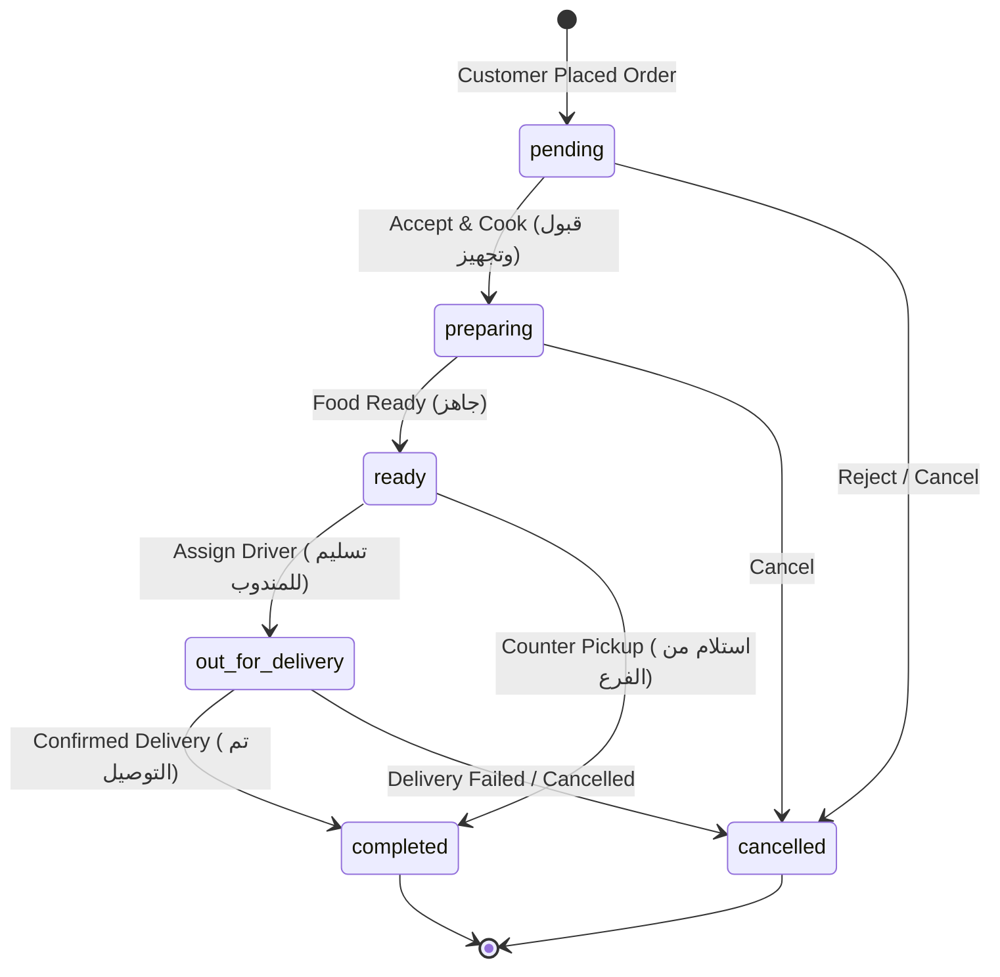

# Manager App API

This document covers manager authentication, store settings and operations, delivery cities and neighborhoods, category and product management, customer management, and the Orders Management integration linked with the customer mobile and web applications.

## Base path and authentication

- Base path: `/api/v1/manager`
- Send and receive JSON using `Content-Type: application/json`.
- Manager endpoints use a Sanctum bearer token.
- Protected manager APIs use `auth:staff_api` and require an active `super_admin` staff account (`staff.role:super_admin`).
- Manager courier management endpoints can create and update courier staff accounts. Other staff roles must be provisioned through a trusted administrative process.
- Product images are stored on Laravel's `public` disk under `storage/app/public/products`. Configure the public storage link with `php artisan storage:link`.

After logging in, send the returned token on protected requests:

```http
Authorization: Bearer <access_token>
```

## Manager login

`POST /api/v1/manager/auth/login`

Accepts a staff username or email as `identifier`:

```json
{
    "identifier": "manager",
    "password": "your-password"
}
```

Successful response: `200 OK`

```json
{
    "data": {
        "access_token": "<plain-text-token>",
        "token_type": "Bearer",
        "staff": {
            "id": "1",
            "username": "manager",
            "email": "manager@example.com",
            "full_name": "Restaurant Manager",
            "role": "super_admin"
        }
    }
}
```

The app must store the access token securely. Do not store or log the manager password or token in plain text.

## Manager logout

`POST /api/v1/manager/auth/logout`

Requires a bearer token. Revokes the current manager token and returns `204 No Content`. There is no response body.

## Store profile and payment settings

These settings are global to the current single-store deployment. There is no branch ID or branch selector. All endpoints in this section require an active `super_admin` bearer token.

### Get store settings

`GET /api/v1/manager/settings`

Returns store names, address, support phone, payment availability, and prepaid-order acceptance settings:

```json
{
    "data": {
        "store_name_ar": "أرواق العنب",
        "store_name_en": "Arwaq Al-Eneab",
        "address": "تبوك، المملكة العربية السعودية",
        "support_phone": "+966500000000",
        "payment_methods": {
            "cash_on_delivery_enabled": true,
            "online_enabled": true
        },
        "auto_accept_prepaid_orders": false
    }
}
```

### Update store settings

`PATCH /api/v1/manager/settings`

All fields are optional; supplied fields are validated and saved together:

| Field                                      | Type           | Rules                                                    |
| ------------------------------------------ | -------------- | -------------------------------------------------------- |
| `store_name_ar`                            | string         | Non-empty after trimming; max 150 characters             |
| `store_name_en`                            | string or null | Non-empty after trimming if not null; max 150 characters |
| `address`                                  | string or null | Max 255 characters                                       |
| `support_phone`                            | string         | Saudi mobile number; max 20 characters                   |
| `payment_methods.cash_on_delivery_enabled` | boolean        | Optional                                                 |
| `payment_methods.online_enabled`           | boolean        | Optional                                                 |
| `auto_accept_prepaid_orders`               | boolean        | Optional                                                 |
| `currency_code`                            | any            | Not accepted; currency is fixed as SAR                   |

At least one payment method must remain enabled. Disabling both returns `422 Unprocessable Content` with a field-level `payment_methods` error. A successful update returns `200 OK` with the persisted settings in the same shape as the GET response.

The current customer checkout supports pickup orders paid by COD only. Disabling COD prevents quote creation and order placement; enabling online payments does not implement a payment gateway.

### Get currency display settings

`GET /api/v1/manager/store/settings`

The store currency is fixed to Saudi riyal. The labels are display-only and do not change stored amounts or perform conversion.

```json
{
    "data": {
        "currency_code": "SAR",
        "currency_label_ar": "ر.س",
        "currency_label_en": "SAR"
    }
}
```

### Update currency display labels

`PATCH /api/v1/manager/store/settings`

Both labels are required, non-empty after trimming, and limited to 20 characters. `currency_code` is response-only and is rejected if supplied.

```json
{
    "currency_label_ar": "ر.س",
    "currency_label_en": "SAR"
}
```

Returns `200 OK` with the canonical currency settings.

## Store hours and order intake

These endpoints manage store-wide hours and order intake. The timezone is fixed to `Asia/Riyadh`. All manager routes require an active `super_admin` bearer token.

### Get operating configuration

`GET /api/v1/manager/hours`

Returns the current intake state, pause expiry, hourly capacity, preparation time, and all seven weekdays in stable Sunday-to-Saturday order:

```json
{
    "data": {
        "is_open": true,
        "paused_until": null,
        "timezone": "Asia/Riyadh",
        "orders_per_hour_limit": 18,
        "estimated_prep_time_minutes": 30,
        "rush_extra_time_enabled": false,
        "rush_extra_time_minutes": 15,
        "weekly_schedule": [
            {
                "day_of_week": "sunday",
                "is_active": true,
                "sessions": [
                    {
                        "name": "dinner",
                        "opens_at": "18:30",
                        "closes_at": "00:30",
                        "closes_next_day": true
                    }
                ]
            }
        ]
    }
}
```

The example abbreviates the schedule; responses contain all seven days. `sessions` can be empty. Times use local 24-hour `HH:mm` values. A `closes_next_day` value of `true` makes the closing time occur on the following local day.

### Replace hours and capacity

`PUT /api/v1/manager/hours`

Send all required fields and exactly one entry per weekday:

```json
{
    "orders_per_hour_limit": 18,
    "estimated_prep_time_minutes": 30,
    "rush_extra_time_enabled": false,
    "weekly_schedule": [
        {
            "day_of_week": "sunday",
            "is_active": true,
            "sessions": [
                {
                    "name": "dinner",
                    "opens_at": "18:30",
                    "closes_at": "00:30",
                    "closes_next_day": true
                }
            ]
        }
    ]
}
```

Validation rules:

| Field                                         | Type    | Rules                                                                           |
| --------------------------------------------- | ------- | ------------------------------------------------------------------------------- |
| `orders_per_hour_limit`                       | integer | 5–500                                                                           |
| `estimated_prep_time_minutes`                 | integer | 10–360 and divisible by 5                                                       |
| `rush_extra_time_enabled`                     | boolean | Required                                                                        |
| `weekly_schedule`                             | array   | Exactly 7 entries; one distinct entry for each weekday                          |
| `weekly_schedule.*.day_of_week`               | string  | `sunday`, `monday`, `tuesday`, `wednesday`, `thursday`, `friday`, or `saturday` |
| `weekly_schedule.*.is_active`                 | boolean | Required                                                                        |
| `weekly_schedule.*.sessions`                  | array   | Required; may be empty                                                          |
| `sessions.*.name`                             | string  | Required; max 30 characters                                                     |
| `sessions.*.opens_at`, `sessions.*.closes_at` | time    | Required; `HH:mm`                                                               |
| `sessions.*.closes_next_day`                  | boolean | Required                                                                        |

Sessions on inactive days are ignored for overlap validation. Active sessions may not overlap, including overnight overlaps with the next day; the closing time must be after the opening time and within 24 hours. Successful saves return `200 OK` with the full persisted configuration.

### Pause order intake

`POST /api/v1/manager/hours/pause`

Send exactly one of the following:

```json
{
    "duration_minutes": 30
}
```

`duration_minutes` accepts `30` or `60`.

To pause until the next calendar day:

```json
{
    "until_tomorrow": true
}
```

“Until tomorrow” ends at the start of the next local calendar day in `Asia/Riyadh`, rather than 720 minutes from now. Repeating a pause replaces the current expiry. The response is `200 OK` with the canonical hours resource and `paused_until` as a UTC timestamp:

```json
{
    "data": {
        "is_open": false,
        "paused_until": "2026-10-29T21:00:00+00:00",
        "timezone": "Asia/Riyadh",
        "orders_per_hour_limit": 18,
        "estimated_prep_time_minutes": 30,
        "rush_extra_time_enabled": false,
        "rush_extra_time_minutes": 15,
        "weekly_schedule": [
            { "day_of_week": "sunday", "is_active": false, "sessions": [] },
            { "day_of_week": "monday", "is_active": false, "sessions": [] },
            { "day_of_week": "tuesday", "is_active": false, "sessions": [] },
            { "day_of_week": "wednesday", "is_active": false, "sessions": [] },
            { "day_of_week": "thursday", "is_active": false, "sessions": [] },
            { "day_of_week": "friday", "is_active": false, "sessions": [] },
            { "day_of_week": "saturday", "is_active": false, "sessions": [] }
        ]
    }
}
```

The schedule is abbreviated in this response example; the API returns all seven entries.

### Close and resume order intake

`POST /api/v1/manager/hours/close` closes order intake indefinitely and clears any pause. `POST /api/v1/manager/hours/resume` reopens order intake and also clears any pause. Both return `200 OK` with the canonical hours resource.

Expired pauses are resumed by the application scheduler (which must run every minute in deployed environments). A status read also clears an expired pause, so clients receive current state even if the scheduler is delayed.

Order quotes and placement return `409 Conflict` when the store is closed or the hourly order limit has been reached. The configured preparation estimate, including the 15-minute rush buffer when enabled, is returned in quotes and stored with the order.

## Delivery cities and neighborhoods

Delivery coverage is managed globally for this single-store deployment. Manager endpoints require an active `super_admin` bearer token. The app can read the customer-facing coverage through `GET /api/v1/customer/store/settings`.

### List delivery cities

`GET /api/v1/manager/delivery-cities`

Returns cities ordered by name, each with its neighborhoods ordered by name:

```json
{
    "data": [
        {
            "id": "10",
            "name": "تبوك",
            "service_status": "active",
            "neighborhoods": [
                {
                    "id": "101",
                    "name": "حي المروج",
                    "delivery_fee": 12,
                    "minimum_order_amount": 35,
                    "is_active": true
                }
            ]
        }
    ]
}
```

`service_status` is one of `active`, `coming_soon`, or `preorder_only`; it is stored independently from neighborhood activation. The current checkout does not support delivery or scheduled orders, so `preorder_only` is descriptive customer-facing data and does not enable scheduled ordering.

### Create a delivery city

`POST /api/v1/manager/delivery-cities`

| Field            | Type   | Rules                                                                       |
| ---------------- | ------ | --------------------------------------------------------------------------- |
| `name`           | string | Required; trimmed; max 100 characters; unique                               |
| `service_status` | string | Optional; `active`, `coming_soon`, or `preorder_only`; defaults to `active` |

Example:

```json
{
    "name": "أملج",
    "service_status": "active"
}
```

Returns `201 Created` with the city, its generated ID, and an empty `neighborhoods` array. Duplicate names return `422 Unprocessable Content`.

### Update a delivery city's status

`PATCH /api/v1/manager/delivery-cities/{city}`

`service_status` is required and must be `active`, `coming_soon`, or `preorder_only`. Returns `200 OK` with the updated city and its neighborhoods. An unknown city returns `404 Not Found`.

### Create a neighborhood

`POST /api/v1/manager/delivery-cities/{city}/neighborhoods`

| Field                  | Type    | Rules                                                         |
| ---------------------- | ------- | ------------------------------------------------------------- |
| `name`                 | string  | Required; trimmed; max 100 characters; unique within the city |
| `delivery_fee`         | number  | Required; 0–999999.99 SAR; maximum two decimal places         |
| `minimum_order_amount` | number  | Required; 0–99999999.99 SAR; maximum two decimal places       |
| `is_active`            | boolean | Required                                                      |

Example:

```json
{
    "name": "حي الروضة",
    "delivery_fee": 15,
    "minimum_order_amount": 40,
    "is_active": true
}
```

Returns `201 Created` with the created neighborhood. Duplicate names within the same city return `422 Unprocessable Content`; an unknown city returns `404 Not Found`.

### Update a neighborhood

`PATCH /api/v1/manager/delivery-neighborhoods/{neighborhood}`

All fields from neighborhood creation are optional. If supplied, they use the same validation rules. At least one field must be supplied. The neighborhood cannot be moved to another city. Returns `200 OK` with the updated neighborhood. An unknown neighborhood returns `404 Not Found`.

## Customer-facing store settings

`GET /api/v1/customer/store/settings` is public and does not require authentication. It returns store display and contact information, fixed currency and labels, payment availability, current order-intake status, estimated preparation time, and delivery coverage:

```json
{
    "data": {
        "store_name_ar": "أرواق العنب",
        "store_name_en": "Arwaq Al-Eneab",
        "address": "تبوك، المملكة العربية السعودية",
        "support_phone": "+966500000000",
        "currency_code": "SAR",
        "currency_label_ar": "ر.س",
        "currency_label_en": "SAR",
        "payment_methods": {
            "cash_on_delivery_enabled": true,
            "online_enabled": true
        },
        "auto_accept_prepaid_orders": false,
        "is_open": true,
        "paused_until": null,
        "estimated_prep_time_minutes": 30,
        "delivery_cities": []
    }
}
```

All cities and their service statuses are included in this customer response, but only active neighborhoods are listed. Amounts remain numeric SAR values; labels are for display only. Online payment availability is configuration only and does not imply that online checkout is currently implemented.

## Categories

Category management includes inactive categories. Public customer catalog endpoints continue to expose only active categories.

### List categories

`GET /api/v1/manager/categories`

Returns categories sorted by `sort_order`, then ID, using Laravel pagination. Optional query parameter:

| Parameter  | Type    | Rules                 |
| ---------- | ------- | --------------------- |
| `per_page` | integer | 1–100; defaults to 20 |

Example:

```http
GET /api/v1/manager/categories?per_page=10
```

Response: `200 OK`

```json
{
    "data": [
        {
            "id": "1",
            "name_ar": "وجبات",
            "name_en": "Meals",
            "slug": "meals",
            "icon_code": "restaurant",
            "sort_order": 1,
            "is_active": true,
            "created_at": "2026-10-25T10:00:00.000000Z",
            "updated_at": "2026-10-25T10:00:00.000000Z"
        }
    ],
    "links": {},
    "meta": {}
}
```

The `links` and `meta` values contain Laravel pagination details and are abbreviated in this example.

### Get a category

`GET /api/v1/manager/categories/{category}`

Returns the category using the same shape as the list item. Returns `404 Not Found` if the category does not exist.

### Create a category

`POST /api/v1/manager/categories`

Required fields:

| Field     | Type   | Rules                                    |
| --------- | ------ | ---------------------------------------- |
| `name_ar` | string | Required; maximum 100 characters         |
| `slug`    | string | Required; maximum 100 characters; unique |

Optional fields:

| Field        | Type           | Rules                    |
| ------------ | -------------- | ------------------------ |
| `name_en`    | string or null | Maximum 100 characters   |
| `icon_code`  | string or null | Maximum 50 characters    |
| `sort_order` | integer        | Minimum 0; defaults to 0 |
| `is_active`  | boolean        | Defaults to true         |

Request example:

```json
{
    "name_ar": "مشروبات",
    "name_en": "Drinks",
    "slug": "drinks",
    "icon_code": "cup",
    "sort_order": 3,
    "is_active": true
}
```

Returns `201 Created` and the newly created category in a `data` envelope.

### Update a category

`PATCH /api/v1/manager/categories/{category}`

`PUT /api/v1/manager/categories/{category}` is also supported. All fields are optional; if supplied, fields follow the same rules as category creation. The slug must remain unique, excluding the current category.

Example partial update:

```json
{
    "name_ar": "المشروبات",
    "is_active": false
}
```

Returns `200 OK` and the updated category in a `data` envelope. Returns `404 Not Found` if the category does not exist.

### Delete a category

`DELETE /api/v1/manager/categories/{category}`

Returns `204 No Content` when deleted. A category that has products cannot be deleted; the API returns `409 Conflict` to protect those products:

```json
{
    "message": "This category cannot be deleted while it contains products.",
    "code": "CATEGORY_HAS_PRODUCTS",
    "errors": {}
}
```

## Reusable product sizes and options

All reusable-catalog endpoints require an active `super_admin` bearer token.

Create reusable sizes and option groups once, then attach them to multiple products. Reusable size descriptions and option-group details/prices are shared. Each product sets its own price for every attached size. Editing reusable size details updates every product using that size without changing their prices. Editing an option group or its choices updates every product using the group, including the shared option prices. Changes affect future product responses and order quotes; existing order item snapshots remain unchanged.

### Reusable size CRUD

| Method           | Endpoint                               | Purpose                                              |
| ---------------- | -------------------------------------- | ---------------------------------------------------- |
| `GET`            | `/api/v1/manager/product-sizes`        | List reusable sizes, including `products_count`      |
| `POST`           | `/api/v1/manager/product-sizes`        | Create a reusable size                               |
| `GET`            | `/api/v1/manager/product-sizes/{size}` | Get a reusable size                                  |
| `PATCH` or `PUT` | `/api/v1/manager/product-sizes/{size}` | Update it and propagate changes to products using it |
| `DELETE`         | `/api/v1/manager/product-sizes/{size}` | Delete an unused reusable size                       |

Create/update fields:

| Field                                              | Type           | Rules                                                                                         |
| -------------------------------------------------- | -------------- | --------------------------------------------------------------------------------------------- |
| `size_key`                                         | string         | Required on create; `small`, `medium`, `large`, `jumbo`, or `family`                          |
| `name_ar`                                          | string         | Required on create; max 50 characters                                                         |
| `name_en`                                          | string or null | Optional; max 50 characters                                                                   |
| `piece_count`                                      | integer        | Required on create; minimum 1                                                                 |
| `portion_description_ar`, `portion_description_en` | string or null | Optional; max 100 characters                                                                  |
| `price`                                            | number         | Required on create; 0–999999.99 SAR; suggested/default price for new product attachments only |

Example create request:

```json
{
    "size_key": "large",
    "name_ar": "كبير",
    "name_en": "Large",
    "piece_count": 8,
    "portion_description_ar": "تكفي شخصين",
    "portion_description_en": "Serves two people",
    "price": 42
}
```

The response includes the created size ID and `products_count`. The library `price` is a suggested value for convenience; a product must send its own price when attaching the reusable size. Updating the library price does not change any existing product prices. Deleting a size attached to any product returns `409 Conflict` with code `SIZE_TEMPLATE_IN_USE`.

### Reusable option-group CRUD

An option group is the reusable section; its `options` are the selectable choices inside that section. Manage the group and its choices together:

| Method           | Endpoint                                      | Purpose                                                                 |
| ---------------- | --------------------------------------------- | ----------------------------------------------------------------------- |
| `GET`            | `/api/v1/manager/option-groups`               | List reusable groups, choices, and `products_count`                     |
| `POST`           | `/api/v1/manager/option-groups`               | Create a reusable group with choices                                    |
| `GET`            | `/api/v1/manager/option-groups/{optionGroup}` | Get a reusable group and its choices                                    |
| `PATCH` or `PUT` | `/api/v1/manager/option-groups/{optionGroup}` | Update group fields and optionally replace its complete `options` array |
| `DELETE`         | `/api/v1/manager/option-groups/{optionGroup}` | Delete an unused reusable group                                         |

Create request:

```json
{
    "name_ar": "النكهة",
    "name_en": "Flavor",
    "type": "single",
    "option_category": "flavor",
    "is_required": true,
    "options": [
        {
            "name_ar": "عادي",
            "name_en": "Regular",
            "price": 0,
            "is_available": true
        },
        {
            "name_ar": "حار",
            "name_en": "Spicy",
            "price": 2,
            "is_available": true
        }
    ]
}
```

Group fields are `name_ar` (required, max 100), `name_en` (optional, max 100), `type` (`single` or `multiple`), `option_category` (`flavor` or `add_on`), and `is_required` (optional boolean). `options` is required on create and must contain 1–50 choices. Each choice accepts `name_ar` (required, max 100), `name_en`, `description_ar`, `description_en`, `price` (0–9999.99 SAR, defaults to 0), and `is_available` (defaults to true). On update, omit `options` to keep all choices unchanged; if supplied, send the complete replacement list. Deleting an attached group returns `409 Conflict` with code `OPTION_GROUP_IN_USE`.

### Attach reusable records to products

After retrieving the library lists, the manager app can present sizes and option groups as checkboxes and send the selected IDs when creating a product:

```json
{
    "category_id": 1,
    "name_ar": "بيتزا الدجاج",
    "base_price": 25,
    "size_templates": [
        {
            "template_id": 3,
            "price": 25,
            "is_default": true
        },
        {
            "template_id": 5,
            "price": 42,
            "is_default": false
        }
    ],
    "option_group_ids": [8, 12]
}
```

`size_templates` and `option_group_ids` can be empty arrays. Each `size_templates` entry must contain a `template_id` from the reusable-size list and the product-specific `price`; optionally mark one entry with `is_default: true`. Selected size templates must have distinct size keys. `option_group_ids` selects reusable option groups; their choice names and prices are shared by every attached product.

## Products

All product endpoints require an active `super_admin` bearer token. Product responses include the complete size list and option groups, including unavailable products and options, so the manager app can edit catalog data.

### List products

`GET /api/v1/manager/products`

Returns products ordered by `sort_order`, then ID, using Laravel pagination.

Optional query parameters:

| Parameter      | Type    | Rules                                                         |
| -------------- | ------- | ------------------------------------------------------------- |
| `category_id`  | integer | Must identify an existing category                            |
| `is_available` | boolean | Filter available/unavailable products                         |
| `search`       | string  | Up to 100 characters; matches Arabic or English product names |
| `per_page`     | integer | 1–100; defaults to 20                                         |

### Get a product

`GET /api/v1/manager/products/{product}`

Returns the product fields, sizes, and option groups in the same shape as the list response. Returns `404 Not Found` if the product does not exist.

### Create a product

`POST /api/v1/manager/products`

Product fields:

| Field                              | Type           | Rules                                                                             |
| ---------------------------------- | -------------- | --------------------------------------------------------------------------------- |
| `category_id`                      | integer        | Required; existing category (active or inactive)                                  |
| `name_ar`                          | string         | Required; max 150 characters                                                      |
| `base_price`                       | number         | Required; 0–999999.99 SAR                                                         |
| `name_en`                          | string or null | Optional; max 150 characters                                                      |
| `description_ar`, `description_en` | string or null | Optional                                                                          |
| `image_url`                        | URL or null    | Optional legacy/external image URL; max 255 characters. Prefer uploading `image`. |
| `image`                            | file           | Optional; JPEG, PNG, or WebP image; maximum 5 MB; sent as `multipart/form-data`   |
| `has_discount`                     | boolean        | Optional; defaults to false                                                       |
| `discount_percentage`              | number         | Optional; 0–100; defaults to 0                                                    |
| `discounted_price`                 | number         | Optional; 0–999999.99 SAR; defaults to 0                                          |
| `is_available`                     | boolean        | Optional; defaults to true                                                        |
| `is_featured`, `is_best_seller`    | boolean        | Optional; defaults to false                                                       |
| `badge_text_ar`                    | string or null | Optional; max 100 characters                                                      |
| `sort_order`                       | integer        | Optional; 0 or greater                                                            |

Sizes and option groups are optional when creating a product. Omit all size fields (`sizes`, `size_templates`, and `size_template_ids`) or send one of them as an empty array to create the product without sizes. Likewise, omit both option fields (`option_groups` and `option_group_ids`) or send one as an empty array to create the product without options. If supplied, provide at most one size field and at most one option field; do not send both alternatives in either pair. `sizes` remains available for product-specific size details and prices. `size_templates` attaches reusable size details while the required `price` on each selection is specific to this product. Legacy `size_template_ids` remains accepted and uses the library suggested price; new integrations should use `size_templates`. `option_groups` remains available for one-off groups, while `option_group_ids` attaches reusable groups with shared option prices. A product without sizes uses `base_price`; otherwise the customer selects a size and uses this product's size price.

Each `size_templates` entry has `template_id` (required, reusable-size ID), `price` (required, 0–999999.99 SAR), and `is_default` (optional boolean; at most one can be true). Up to five size templates can be selected, and their `size_key` values must be distinct. For existing clients, `size_template_ids` remains an array of up to five IDs, with optional `default_size_template_id` from that array. `option_group_ids` is an array of up to 20 distinct IDs from `/api/v1/manager/option-groups`. Product responses include `template_id` for attached reusable sizes (`null` for product-specific sizes); option group responses include `is_reusable`.

Each `sizes` item:

| Field                                              | Type           | Rules                                                                                 |
| -------------------------------------------------- | -------------- | ------------------------------------------------------------------------------------- |
| `size_key`                                         | string         | Required; `small`, `medium`, `large`, `jumbo`, or `family`; unique within the product |
| `name_ar`                                          | string         | Required; max 50 characters                                                           |
| `name_en`                                          | string or null | Optional; max 50 characters                                                           |
| `piece_count`                                      | integer        | Required; minimum 1                                                                   |
| `price`                                            | number         | Required; 0–999999.99 SAR                                                             |
| `portion_description_ar`, `portion_description_en` | string or null | Optional; max 100 characters                                                          |
| `is_default`                                       | boolean        | Optional; at most one size may be default                                             |

Each `option_groups` item:

| Field             | Type           | Rules                            |
| ----------------- | -------------- | -------------------------------- |
| `name_ar`         | string         | Required; max 100 characters     |
| `name_en`         | string or null | Optional; max 100 characters     |
| `type`            | string         | Required; `single` or `multiple` |
| `option_category` | string         | Required; `flavor` or `add_on`   |
| `is_required`     | boolean        | Optional; defaults to false      |
| `options`         | array          | Required; 1–50 options           |

Each option in a group:

| Field                              | Type           | Rules                                  |
| ---------------------------------- | -------------- | -------------------------------------- |
| `name_ar`                          | string         | Required; max 100 characters           |
| `name_en`                          | string or null | Optional; max 100 characters           |
| `description_ar`, `description_en` | string or null | Optional                               |
| `price`                            | number         | Optional; 0–9999.99 SAR; defaults to 0 |
| `is_available`                     | boolean        | Optional; defaults to true             |

The request hierarchy is `option_groups` → `options`: each option group is a selectable section in the customer app, and its `options` are the choices inside that section (sometimes called sub-options in the app UI). The API does not accept another nested `suboptions` array. IDs are generated by the API, so do not include IDs when creating a product.

Creation example (JSON body):

```json
{
    "category_id": 1,
    "name_ar": "بيتزا الدجاج",
    "name_en": "Chicken Pizza",
    "description_ar": "بيتزا بالدجاج والخضار",
    "base_price": 25,
    "has_discount": false,
    "discount_percentage": 0,
    "discounted_price": 25,
    "is_available": true,
    "is_featured": true,
    "is_best_seller": false,
    "badge_text_ar": "جديد",
    "sort_order": 1,
    "sizes": [
        {
            "size_key": "small",
            "name_ar": "صغير",
            "name_en": "Small",
            "piece_count": 4,
            "portion_description_ar": "تكفي شخصًا واحدًا",
            "portion_description_en": "Serves one person",
            "price": 25,
            "is_default": true
        },
        {
            "size_key": "large",
            "name_ar": "كبير",
            "name_en": "Large",
            "piece_count": 8,
            "portion_description_ar": "تكفي شخصين",
            "portion_description_en": "Serves two people",
            "price": 42,
            "is_default": false
        }
    ],
    "option_groups": [
        {
            "name_ar": "النكهة",
            "name_en": "Flavor",
            "type": "single",
            "option_category": "flavor",
            "is_required": true,
            "options": [
                {
                    "name_ar": "عادي",
                    "name_en": "Regular",
                    "description_ar": "نكهة البيتزا العادية",
                    "description_en": "Regular pizza flavor",
                    "price": 0,
                    "is_available": true
                },
                {
                    "name_ar": "حار",
                    "name_en": "Spicy",
                    "description_ar": "نكهة حارة",
                    "description_en": "Spicy flavor",
                    "price": 0,
                    "is_available": true
                }
            ]
        },
        {
            "name_ar": "إضافات",
            "name_en": "Add-ons",
            "type": "multiple",
            "option_category": "add_on",
            "is_required": false,
            "options": [
                {
                    "name_ar": "جبنة إضافية",
                    "name_en": "Extra cheese",
                    "description_ar": "إضافة جبنة إلى البيتزا",
                    "description_en": "Add extra cheese to the pizza",
                    "price": 5,
                    "is_available": true
                },
                {
                    "name_ar": "زيتون",
                    "name_en": "Olives",
                    "description_ar": "إضافة زيتون",
                    "description_en": "Add olives",
                    "price": 3,
                    "is_available": true
                }
            ]
        }
    ]
}
```

In the Android app, render each `option_groups` entry as a section and its `options` array as the selectable choices within that section. For example, `النكهة` is a required single-choice section, while `إضافات` allows multiple selections. This JSON example represents text fields only. When uploading a file, submit the same fields as `multipart/form-data` and include an `image` file; do not send `image_url` together with `image`. The `image_url` response value is generated by the API; the database stores the relative path.

Returns `201 Created` and the saved product with generated IDs for the product, sizes, groups, and options. Product and nested records are created in one transaction; invalid nested input leaves no partial product.

To upload an image during product creation, submit the product and nested values as `multipart/form-data`, attaching the file as `image`. Use bracketed form keys for nested arrays, such as `sizes[0][size_key]`, `size_templates[0][template_id]`, `size_templates[0][price]`, `option_groups[0][name_ar]`, and `option_group_ids[0]`. Do not send `image_url` together with `image`.

Example response shape:

```json
{
    "data": {
        "id": "15",
        "category_id": "1",
        "name_ar": "بيتزا الدجاج",
        "name_en": "Chicken Pizza",
        "description_ar": "بيتزا بالدجاج والخضار",
        "description_en": null,
        "image_url": "https://your-domain.example/storage/products/unique-image-name.jpg",
        "base_price": 25,
        "has_discount": false,
        "discount_percentage": 0,
        "discounted_price": 25,
        "is_available": true,
        "is_featured": true,
        "is_best_seller": false,
        "badge_text_ar": "جديد",
        "sort_order": 1,
        "sizes": [
            {
                "id": "27",
                "template_id": "3",
                "size_key": "small",
                "name_ar": "صغير",
                "name_en": "Small",
                "piece_count": 4,
                "portion_description_ar": "تكفي شخصًا واحدًا",
                "portion_description_en": null,
                "price": 25,
                "is_default": true
            }
        ],
        "option_groups": [
            {
                "id": "8",
                "name_ar": "النكهة",
                "name_en": "Flavor",
                "type": "single",
                "option_category": "flavor",
                "is_required": true,
                "options": [
                    {
                        "id": "31",
                        "name_ar": "عادي",
                        "name_en": "Regular",
                        "description_ar": null,
                        "description_en": null,
                        "price": 0,
                        "is_available": true
                    }
                ]
            }
        ],
        "created_at": "2026-10-25T10:00:00.000000Z",
        "updated_at": "2026-10-25T10:00:00.000000Z"
    }
}
```

### Update a product

`PATCH /api/v1/manager/products/{product}`

`PUT /api/v1/manager/products/{product}` is also supported. Product fields are optional and use the same validation as creation when supplied. Nested behavior:

- Omit `sizes` to leave the existing sizes unchanged.
- Send a complete `sizes` array to replace all sizes; send `[]` to remove all sizes.
- Instead of `sizes`, send a complete `size_templates` array to attach reusable size details with product-specific prices; send `size_templates: []` to remove all sizes. Each selected size needs a `template_id` and `price`.
- Legacy clients may send `size_template_ids` and `default_size_template_id`; this uses the library suggested price. Send `size_template_ids: []` to remove all sizes.
- Omit `option_groups` to leave existing option groups unchanged.
- Send a complete `option_groups` array to replace all groups and their options; send `[]` to remove all groups.
- Instead of `option_groups`, send `option_group_ids` to replace the product's option groups with reusable groups; send `option_group_ids: []` to remove all groups. Detaching a reusable group does not delete it from the library.
- Omit `image` to keep the current image while updating other product fields. A missing or `null` `image_url` does not change the current image; use `POST /api/v1/manager/products/{product}/image` with an `image` file to replace it, or `DELETE /api/v1/manager/products/{product}/image` to remove it. A non-null `image_url` can still be supplied to set a legacy/external URL.
- Nested records are recreated on replacement and receive new IDs. Other products that share an existing option group keep their relation and data.

When updating with a file, use `multipart/form-data` and include `_method=PATCH` (or `_method=PUT`) because PHP does not reliably parse multipart file bodies sent directly with HTTP `PATCH`/`PUT`. Use bracketed nested form keys as described in the create section.

Example partial update:

```json
{
    "name_ar": "بيتزا الدجاج الجديدة",
    "is_available": false,
    "sizes": []
}
```

Returns `200 OK` and the updated product. The product field updates and any nested replacement run atomically.

### Upload or replace a product image

`POST /api/v1/manager/products/{product}/image`

Requires the manager bearer token. Send a required `image` field as `multipart/form-data`. JPEG, PNG, or WebP files up to 5 MB are accepted. The previous managed image is deleted after the new upload is stored and associated with the product.

```bash
curl -X POST "https://your-domain.example/api/v1/manager/products/15/image" \
  -H "Authorization: Bearer <access_token>" \
  -F "image=@chicken-pizza.jpg"
```

Returns `200 OK` with the updated product and its public `image_url`.

### Delete a product image

`DELETE /api/v1/manager/products/{product}/image`

Clears the product image and deletes its managed storage file. Returns `200 OK`:

```json
{
    "data": {
        "id": "15",
        "image_url": null
    }
}
```

### Delete a product

`DELETE /api/v1/manager/products/{product}`

Returns `204 No Content` when deleted. A product referenced by any order item cannot be deleted, to preserve historical order details. In that case, the API returns `409 Conflict`:

```json
{
    "message": "This product cannot be deleted because it appears in order history.",
    "code": "PRODUCT_HAS_ORDERS",
    "errors": {}
}
```

When a product is deleted, its managed image, size variants, and unshared option groups/options are removed. Option groups still associated with another product are retained. The image remains untouched if deletion is refused due to order history.

Product changes affect future catalog reads and quotes. Existing order item snapshots are not rewritten.

## Customer management

These endpoints let the manager app search and manage customer accounts, review their order history, and export customer records. All endpoints require the manager bearer token and an active `super_admin` staff account. Customer profiles are stored in `users`; addresses and orders are returned from their existing customer records.

### Endpoints

| Method  | Path                                                | Purpose                                                  |
| ------- | --------------------------------------------------- | -------------------------------------------------------- |
| `GET`   | `/api/v1/manager/customers/stats`                   | Customer KPIs for a date period                          |
| `POST`  | `/api/v1/manager/customers`                         | Create a customer profile pending phone OTP verification |
| `GET`   | `/api/v1/manager/customers`                         | Search, filter, sort, and paginate customers             |
| `GET`   | `/api/v1/manager/customers/{customer}`              | Customer profile, saved addresses, and order summary     |
| `GET`   | `/api/v1/manager/customers/{customer}/orders`       | Paginated order history for one customer                 |
| `PATCH` | `/api/v1/manager/customers/{customer}`              | Edit customer details and VIP status                     |
| `PATCH` | `/api/v1/manager/customers/{customer}/verification` | Set or clear manager review status                       |
| `PATCH` | `/api/v1/manager/customers/{customer}/status`       | Block or reactivate the account                          |
| `GET`   | `/api/v1/manager/customers/export`                  | Download filtered customer rows as CSV                   |

Static routes such as `/customers/stats` and `/customers/export` are registered before the `{customer}` route. Do not treat these path values as customer IDs.

### Create a customer profile

`POST /api/v1/manager/customers`

Request fields:

| Field       | Type           | Rules                                                                                                     |
| ----------- | -------------- | --------------------------------------------------------------------------------------------------------- |
| `full_name` | string         | Required; max 100 characters                                                                              |
| `phone`     | string         | Required Saudi mobile number; accepts `05XXXXXXXX`, `5XXXXXXXX`, `9665XXXXXXXX`, or `+9665XXXXXXXX` forms |
| `email`     | string or null | Optional; valid email; max 191 characters; unique when supplied                                           |

Example:

```json
{
    "full_name": "نورة السبيعي",
    "phone": "0559981240",
    "email": null
}
```

Returns `201 Created` with the customer resource. Phone numbers are saved in canonical `+9665XXXXXXXX` form. A new profile starts with `status: "active"`, `is_vip: false`, `phone_verified_at: null`, and no manager verification. The endpoint does not create a customer access token or bypass customer OTP verification; the customer must sign in through the existing OTP flow to verify ownership of the phone.

### List, search, filter, and sort customers

`GET /api/v1/manager/customers`

Optional query parameters:

| Parameter    | Type    | Rules                                                                                           |
| ------------ | ------- | ----------------------------------------------------------------------------------------------- |
| `search`     | string  | Matches customer name, phone, email, or saved address city/district/street in Arabic or English |
| `segment`    | string  | `all` (default), `vip`, `frequent`, `new`, or `inactive`                                        |
| `status`     | string  | `all` (default), `active`, or `blocked`                                                         |
| `sort_by`    | string  | `last_order_at` (default), `total_orders_count`, `total_spent_amount`, or `created_at`          |
| `sort_order` | string  | `desc` (default) or `asc`                                                                       |
| `page`       | integer | One-based page number; defaults to 1                                                            |
| `per_page`   | integer | 1–50; defaults to 15                                                                            |

The response uses Laravel pagination (`data`, `links`, and `meta`). A list item contains the same identity, verification, segment, primary address, and aggregate fields as this abbreviated example:

```json
{
    "data": [
        {
            "id": 101,
            "full_name": "خالد الشمري",
            "phone": "+966530697231",
            "email": null,
            "status": "active",
            "is_vip": true,
            "phone_verified_at": "2026-10-31T10:40:00+03:00",
            "is_phone_verified": true,
            "manager_verified_at": null,
            "manager_verified_by_staff_user_id": null,
            "is_manager_verified": false,
            "created_at": "2026-09-20T10:00:00+03:00",
            "segments": ["vip", "frequent"],
            "primary_address": {
                "city": "تبوك",
                "district": "حي المروج",
                "street_details": "شارع الملك فهد"
            },
            "total_orders_count": 24,
            "total_spent_amount": "1420.00",
            "currency": "SAR",
            "favorite_item": "بوكس ميكس ورق عنب وملفوف (كبير)",
            "last_order_at": "2026-10-31T10:48:00+03:00"
        }
    ],
    "links": {},
    "meta": {}
}
```

`primary_address` and `last_order_at` are `null` when unavailable. A customer can belong to more than one segment; account `status` is returned separately. `frequent` means at least 10 completed/delivered orders, `new` means the account was created in the last 30 days, and `inactive` means no completed/delivered order in the last 30 days (including customers with no completed orders). `vip` follows `is_vip`.

The current list resource also includes the full `addresses` array described below; list cards can use `primary_address` and ignore the full array unless needed.

Order counts and spend include only `delivered` or `completed` orders. The favorite item is based on the greatest total purchased quantity from order item name snapshots. `last_order_at` is the latest order creation timestamp, including orders that are not completed. These values are computed from orders; the legacy `users.total_orders_count`, `total_spent_amount`, and `last_order_at` fields are not maintained by the current checkout/order flow and must not be treated as authoritative.

### Customer profile and saved addresses

`GET /api/v1/manager/customers/{customer}`

Returns the customer resource plus the complete `addresses` array. Address objects include `id`, `title_ar`, `title_en`, `city_ar`, `city_en`, `district_ar`, `district_en`, `street_details_ar`, `street_details_en`, `latitude`, `longitude`, `notes`, and `is_default`. The response also includes account status, VIP and verification fields, `created_at`, order totals, favorite item, last order time, and currency. Passwords, OTP values, and customer access tokens are never included.

Unknown customer IDs return `404 Not Found`.

### Customer order history

`GET /api/v1/manager/customers/{customer}/orders`

Optional query parameters:

| Parameter  | Type    | Rules                                                                                                                      |
| ---------- | ------- | -------------------------------------------------------------------------------------------------------------------------- |
| `page`     | integer | One-based page number; defaults to 1                                                                                       |
| `per_page` | integer | 1–50; defaults to 15                                                                                                       |
| `status`   | string  | `all` (default), `pending`, `preparing`, `ready`, `out_for_delivery`, `delivered`, `completed`, `cancelled`, or `rejected` |

The response is Laravel-paginated and uses the same row shape as `GET /api/v1/manager/orders`, including order/customer, delivery, item preview/count, payment, and total fields. The query is constrained to the requested customer's `user_id`; it cannot expose another customer's orders. Use `GET /api/v1/manager/orders/{order}` to open a selected order's full details.

### Edit customer information

`PATCH /api/v1/manager/customers/{customer}`

Send any subset of these fields:

| Field       | Type           | Rules                                                 |
| ----------- | -------------- | ----------------------------------------------------- |
| `full_name` | string         | Non-empty; max 100 characters                         |
| `phone`     | string         | Valid Saudi mobile number; unique after normalization |
| `email`     | string or null | Valid email; max 191 characters; unique when supplied |
| `is_vip`    | boolean        | Sets or clears the VIP segment                        |

Example:

```json
{
    "full_name": "خالد الشمري",
    "phone": "0551234567",
    "email": "khalid@example.test",
    "is_vip": true
}
```

Returns `200 OK` with the updated customer resource. Changing the phone number saves its canonical form, clears `phone_verified_at` and the manager review fields, and revokes all existing customer Sanctum tokens. The customer must verify the new phone through OTP again. Phone duplicate checks recognize common legacy number formats. The configured database currently uses MyISAM and has no unique phone index, so duplicate enforcement is application-level; normalize legacy numbers before adding a database unique index.

### Manager account verification

`PATCH /api/v1/manager/customers/{customer}/verification`

Request:

```json
{ "is_verified": true }
```

`is_verified` is required and boolean. When true, the API sets `manager_verified_at` and `manager_verified_by_staff_user_id` to the current timestamp and authenticated manager. When false, both fields are cleared. Returns the customer ID, `phone_verified_at`, manager verification timestamp and reviewer ID, and `is_manager_verified`.

Manager review is an administrative attestation and is separate from proof that the customer owns the phone. This endpoint never sets `phone_verified_at`, issues a customer token, or bypasses OTP verification. Use `is_phone_verified` for phone ownership and `is_manager_verified` for manager review.

### Block or reactivate an account

`PATCH /api/v1/manager/customers/{customer}/status`

Request:

```json
{ "status": "blocked" }
```

`status` is required and must be `active` or `blocked`. Blocking revokes all current customer Sanctum tokens and prevents future customer OTP login. Reactivating allows the customer to sign in again through OTP. Returns `{ "data": { "id": 101, "status": "blocked" } }` with `200 OK`. Customer records are not hard-deleted, preserving order history.

### Customer statistics

`GET /api/v1/manager/customers/stats`

Optional `from` and `to` dates use `YYYY-MM-DD`; `to` cannot precede `from`. With no dates, the API uses the trailing 30 calendar days through today and compares with the preceding period of equal length. `active_customers` counts distinct customers with a completed/delivered order during the selected period; `average_order_value` is completed/delivered revenue divided by completed/delivered order count, or `0.00` when there are no such orders.

Example response:

```json
{
    "data": {
        "total_customers": 1420,
        "active_customers": 890,
        "vip_customers": 245,
        "average_order_value": "84.00",
        "currency": "SAR",
        "period": { "from": "2026-10-01", "to": "2026-10-31" },
        "comparison": {
            "active_customers_change_percent": 12.0,
            "average_order_value_change": "5.00"
        }
    }
}
```

`total_customers` and `vip_customers` are current totals, including blocked customers. `active_customers_change_percent` is `null` when the preceding period had zero active customers because a percentage change from zero is undefined. Date-window completion time uses `delivered_at`, falling back to `updated_at` for older orders where `delivered_at` is empty.

### Export customer records

`GET /api/v1/manager/customers/export`

Accepts the `search`, `segment`, and `status` filters described for the customer list. Returns a downloadable UTF-8 CSV file with a BOM for Arabic text. Columns are name, phone, email, account status, VIP, primary address, completed order count, completed spend, last order time, and favorite item. The export excludes secrets and unsupported wallet/coupon fields.

### Customer API errors

- `401 Unauthorized`: missing or invalid manager bearer token.
- `403 Forbidden`: staff account is inactive or lacks the `super_admin` role.
- `404 Not Found`: customer does not exist.
- `422 Unprocessable Content`: invalid filter, phone/email, or request payload.

Wallet credits, loyalty adjustments, coupon grants, and customer deletion are not provided by these APIs. Use account blocking instead of deleting a customer; the order history must be preserved.

## Orders management

This section provides the complete API specification and runtime integration connecting the **Orders Management Screens** (`OrdersManagementScreen` and `OrderDetailsScreen`) in the Arwaq Al-Eneab (أرواق العنب) Manager App with the backend, integrating the client-side forecasts with the customer ordering lifecycle.

### 1. Integration Linkage with Customer App

The backend links the Manager App and the Customer App seamlessly:

- Customer places an order via `POST /api/v1/orders` from an authoritative quote (`POST /api/v1/checkout/quote`), which is stored in `orders` with initial status `received` (or `pending_confirmation`).
- The order appears immediately in the Manager App under the **جديدة (New / Pending)** tab and triggers the KPI `needs_action_count`.
- When the manager updates the status via `PATCH /api/v1/manager/orders/{order}/status`, the status change is written to `orders.order_status` and audited in `order_status_logs`.
- The customer tracking endpoint (`GET /api/v1/orders/{order}/track`) and details endpoint (`GET /api/v1/orders/{order}`) reflect the change in real time, preventing customer cancellation once preparation begins (`can_cancel: false`).
- Assigning a delivery courier (`POST /api/v1/manager/orders/{order}/assign-driver`) sets `courier_id` without changing the order status. Once the order is ready, the courier confirms pickup to change it to `out_for_delivery` and set `dispatched_at`, which updates the customer's tracking view.
- When an order is cancelled or rejected (via manager `POST /api/v1/manager/orders/{order}/cancel` or customer `POST /api/v1/orders/{order}/cancel`), any redeemed coupon is automatically restored, and the reason is recorded and returned to the customer.

#### Status Mapping & State Machine

| Manager Code              | Manager Tab / Label           | Customer DB Status                  | Customer Display (AR) | Next Permitted Transitions                   |
| :------------------------ | :---------------------------- | :---------------------------------- | :-------------------- | :------------------------------------------- |
| `pending`                 | جديدة (New)                   | `received` / `pending_confirmation` | تم استلام الطلب       | `preparing`, `cancelled`                     |
| `preparing`               | قيد التجهيز (Preparing)       | `preparing`                         | قيد التحضير           | `ready`, `cancelled`                         |
| `ready`                   | جاهز للاستلام (Ready)         | `ready` / `ready_for_pickup`        | جاهز للاستلام         | `out_for_delivery`, `completed`, `cancelled` |
| `out_for_delivery`        | مع المندوب (Out for Delivery) | `out_for_delivery`                  | في الطريق إليك        | `delivered`, `cancelled`                     |
| `completed` / `delivered` | مكتملة (Completed)            | `delivered`                         | تم التوصيل            | None (Terminal)                              |
| `cancelled`               | ملغية (Cancelled)             | `cancelled`                         | ملغي                  | None (Terminal)                              |



---

### 2. Required Endpoints Summary

| Method  | Endpoint                                       | Description                                                                                |
| :------ | :--------------------------------------------- | :----------------------------------------------------------------------------------------- |
| `GET`   | `/api/v1/manager/orders/stats`                 | KPI summary statistics (pending, preparing, delivering, completed today, revenue)          |
| `GET`   | `/api/v1/manager/orders`                       | Paginated orders list with status, payment, delivery mode, search, and sorting             |
| `GET`   | `/api/v1/manager/orders/{order}`               | Complete order details, customer contact, address GPS, items, add-ons, and 5-step timeline |
| `PATCH` | `/api/v1/manager/orders/{order}/status`        | Move order to next workflow stage or set status explicitly with notes                      |
| `POST`  | `/api/v1/manager/orders/{order}/assign-driver` | Assign an available courier without dispatching the order                                 |
| `GET`   | `/api/v1/manager/drivers`                      | List active delivery couriers with workload and availability                               |
| `GET`   | `/api/v1/manager/courier/dashboard`            | Courier-only assigned deliveries and KPI totals                                             |
| `PATCH` | `/api/v1/manager/courier/availability`         | Courier-only online / offline setting                                                       |
| `POST`  | `/api/v1/manager/courier/orders/{order}/pickup`| Courier-only confirmation of restaurant pickup                                              |
| `POST`  | `/api/v1/manager/courier/orders/{order}/deliver`| Courier-only delivery confirmation and COD collection                                      |
| `POST`  | `/api/v1/manager/courier/orders/{order}/issues`| Courier-only delivery issue audit                                                          |
| `POST`  | `/api/v1/manager/drivers/{driver}/cash-settlements`| Manager cash reconciliation for one courier                                              |
| `POST`  | `/api/v1/manager/orders/{order}/cancel`        | Cancel order with cancellation reason and release coupon                                   |
| `GET`   | `/api/v1/manager/orders/{order}/print-ticket`  | Thermal printer receipt data payload for kitchen (KDS) & invoice printing                  |
| `GET`   | `/api/v1/manager/orders/poll`                  | Live order polling and background sync endpoint                                            |

---

### 3. Endpoint Specifications

#### 3.1 Get Orders KPI Statistics

`GET /api/v1/manager/orders/stats`

Requires manager Bearer token. Returns real-time metrics for top summary cards and urgency alert banners.

Response: `200 OK`

```json
{
    "data": {
        "needs_action_count": 4,
        "preparing_count": 5,
        "out_for_delivery_count": 3,
        "completed_today_count": 28,
        "total_today_count": 40,
        "has_urgent_orders": true,
        "urgent_orders_count": 2,
        "today_revenue": "1845.50",
        "currency": "SAR"
    }
}
```

Fields:

- `needs_action_count` (`integer`): Orders in `pending` status awaiting manager action.
- `preparing_count` (`integer`): Orders currently in kitchen preparation.
- `out_for_delivery_count` (`integer`): Orders dispatched with delivery couriers.
- `completed_today_count` (`integer`): Orders delivered or picked up today (`Asia/Riyadh`).
- `has_urgent_orders` (`boolean`): True if any pending orders are older than 5 minutes or approaching prep limits.
- `urgent_orders_count` (`integer`): Count of urgent pending orders.
- `today_revenue` (`string`): Total revenue for completed orders today formatted to 2 decimals.
- `currency` (`string`): Always `"SAR"`.

---

#### 3.2 List Orders (with Filters & Pagination)

`GET /api/v1/manager/orders`

Retrieves orders list matching the Flutter `OrderSummary` card model.

Query Parameters:

- `status`: `all` (default), `pending`, `preparing`, `ready`, `out_for_delivery`, `completed`, `cancelled`.
- `payment_type`: `all` (default), `cash`, `online`.
- `delivery_type`: `all` (default), `delivery`, `pickup`.
- `search`: Free text matching order number (e.g. `ARW-9482`), customer name, or phone number.
- `page`: Page number (default: 1).
- `per_page`: Number of records per page (default: 15, max: 50).
- `sort_by`: `created_at` (default) or `target_time`.
- `sort_order`: `desc` (default) or `asc`.

Response: `200 OK`

```json
{
    "data": [
        {
            "id": 9482,
            "order_number": "ARW-9482",
            "status": "preparing",
            "status_label": "قيد التجهيز",
            "status_color_hex": "#D4AF37",
            "is_urgent": true,
            "created_at": "2026-10-30T15:37:00Z",
            "time_ago": "قبل 12 دقيقة",
            "target_ready_time": "2026-10-30T15:55:00Z",
            "remaining_minutes": 6,
            "customer": {
                "id": 101,
                "name": "أبو ياسر",
                "phone": "0530697231",
                "badge": "عميل مميز (VIP)",
                "badge_type": "vip"
            },
            "delivery": {
                "type": "delivery",
                "type_label": "توصيل منزلي",
                "short_address": "حي المروج - فيلا رقم 14",
                "driver_name": "طارق الزهراني",
                "driver_phone": "0509988112"
            },
            "items_count": 2,
            "items_preview": [
                "بوكس ميكس ورق عنب + ملفوف (50 قطعة)",
                "فتة ورق عنب ملكية بالرمان"
            ],
            "notes": "دبس رمان زيادة، التوصيل للدور الأرضي",
            "total_amount": "57.00",
            "currency": "SAR",
            "payment": {
                "method": "cash_on_delivery",
                "method_label": "الدفع عند الاستلام",
                "type": "cash",
                "is_paid": false,
                "status": "unpaid"
            }
        }
    ],
    "meta": {
        "current_page": 1,
        "last_page": 3,
        "per_page": 15,
        "total": 40
    }
}
```

---

#### 3.3 Get Order Full Details

`GET /api/v1/manager/orders/{order}`

Retrieves complete information for `OrderDetailsScreen`, including customer contact details, WhatsApp direct deep-link, Google Maps GPS coordinates, options and add-ons breakdown, financials, and a 5-step visual stepper timeline.

Response: `200 OK`

```json
{
    "data": {
        "id": 9482,
        "order_number": "ARW-9482",
        "status": "preparing",
        "status_label": "قيد التجهيز",
        "current_step_index": 1,
        "is_urgent": true,
        "urgent_reason": "متبقي 8 دقائق على موعد التسليم المستهدف",
        "created_at": "2026-10-30T15:37:00Z",
        "order_time_formatted": "08:22 م",
        "target_ready_time": "2026-10-30T15:55:00Z",
        "target_delivery_time": "2026-10-30T16:15:00Z",
        "remaining_minutes": 8,
        "customer": {
            "id": 101,
            "name": "أبو ياسر",
            "phone": "0530697231",
            "badge": "عميل مميز (VIP)",
            "badge_type": "vip",
            "total_orders_count": 24,
            "whatsapp_url": "https://wa.me/966530697231?text=%D9%85%D8%B1%D8%AD%D8%A8%D8%A7%D9%8B%20%D8%A3%D8%A8%D9%88%20%D9%8A%D8%A7%D8%B3%D8%B1..."
        },
        "delivery": {
            "type": "delivery",
            "type_label": "توصيل منزلي",
            "city": "تبوك",
            "neighborhood": "حي المروج",
            "street_address": "حي المروج - فيلا رقم 14",
            "building_details": "توصيل مباشر للباب • الدور الأرضي بجوار مسجد الإيمان",
            "latitude": 28.3998,
            "longitude": 36.5715,
            "google_maps_url": "https://www.google.com/maps/search/?api=1&query=28.3998,36.5715",
            "driver": {
                "id": 5,
                "name": "طارق الزهراني",
                "phone": "0509988112",
                "vehicle_type": "دباب / سكوتر"
            }
        },
        "items": [
            {
                "id": 301,
                "product_id": 12,
                "product_name": "بوكس ميكس ورق عنب + ملفوف",
                "size_name": "حجم كبير • 50 قطعة",
                "quantity": 1,
                "unit_price": "40.00",
                "line_total": "40.00",
                "selected_addons": [
                    {
                        "group_name": "الصلصات والإضافات",
                        "option_name": "صوص دبس رمان غني إضافي",
                        "price": "0.00",
                        "quantity": 1
                    }
                ],
                "notes": "زيادة دبس الرمان"
            }
        ],
        "financials": {
            "items_subtotal": "57.00",
            "delivery_fee": "12.00",
            "discount_amount": "0.00",
            "coupon_code": null,
            "tax_rate_percent": 15,
            "tax_amount": "9.00",
            "tax_included_in_subtotal": true,
            "total_amount": "69.00",
            "currency": "SAR",
            "payment_method": "cash_on_delivery",
            "payment_method_label": "الدفع عند الاستلام (كاش / شبكة)",
            "payment_type": "cash",
            "payment_status": "unpaid",
            "payment_status_label": "غير مسددة بعد"
        },
        "timeline": [
            {
                "step_index": 0,
                "step_key": "pending",
                "title": "مستلم",
                "desc": "تم استلام الطلب وبانتظار الموافقة",
                "completed": true,
                "timestamp": "2026-10-30T15:37:00Z"
            },
            {
                "step_index": 1,
                "step_key": "preparing",
                "title": "بالتجهيز",
                "desc": "بالمطبخ الآن",
                "completed": true,
                "timestamp": "2026-10-30T15:40:12Z"
            },
            {
                "step_index": 2,
                "step_key": "ready",
                "title": "جاهز",
                "desc": "مغلّف وجاهز للتسليم",
                "completed": false,
                "timestamp": null
            },
            {
                "step_index": 3,
                "step_key": "out_for_delivery",
                "title": "مع المندوب",
                "desc": "بالطريق للزبون",
                "completed": false,
                "timestamp": null
            },
            {
                "step_index": 4,
                "step_key": "delivered",
                "title": "تم التسليم",
                "desc": "طلب ناجح ومكتمل",
                "completed": false,
                "timestamp": null
            }
        ]
    }
}
```

---

#### 3.4 Update Order Status

`PATCH /api/v1/manager/orders/{order}/status`

Advances the order through its workflow stages. Accepts `status` (or legacy `to_status`) and optional `note`.

Request Body:

```json
{
    "status": "preparing",
    "note": "تم بدء التجهيز في المطبخ"
}
```

Response: `200 OK`

```json
{
    "data": {
        "id": 9482,
        "order_number": "ARW-9482",
        "status": "preparing",
        "status_label": "قيد التجهيز",
        "current_step_index": 1,
        "updated_at": "2026-10-30T15:42:00Z"
    },
    "message": "تم تحديث حالة الطلب #ARW-9482 إلى 'قيد التجهيز' بنجاح"
}
```

---

#### 3.5 Assign Delivery Driver

`POST /api/v1/manager/orders/{order}/assign-driver`

Assigns an active delivery courier (`role: courier`) to the order. Automatically updates order status to `out_for_delivery` if it was in `ready` or `preparing`.

Request Body:

```json
{
    "driver_id": 5,
    "notify_driver": true
}
```

Response: `200 OK`

```json
{
    "data": {
        "order_id": 9482,
        "order_number": "ARW-9482",
        "status": "out_for_delivery",
        "driver": {
            "id": 5,
            "name": "طارق الزهراني",
            "phone": "0509988112",
            "assigned_at": "2026-10-30T15:43:00Z"
        }
    },
    "message": "تم تعيين المندوب طارق الزهراني للطلب بنجاح"
}
```

---

#### 3.6 Courier Management

`GET /api/v1/manager/drivers`

Lists active delivery couriers and their current active orders workload. Pass `?include_inactive=true` to include deactivated couriers for management. Each record includes `username`, `email`, and `is_active` in addition to assignment workload fields.

Response: `200 OK`

```json
{
    "data": [
        {
            "id": 5,
            "username": "tariq",
            "email": "tariq@example.test",
            "name": "طارق الزهراني",
            "phone": "0509988112",
            "is_active": true,
            "is_available": true,
            "active_orders_count": 1,
            "vehicle_type": "دباب / سكوتر"
        },
        {
            "id": 7,
            "username": "saad",
            "email": "saad@example.test",
            "name": "سعد المطيري",
            "phone": "0551122334",
            "is_active": true,
            "is_available": true,
            "active_orders_count": 0,
            "vehicle_type": "سيارة"
        }
    ]
}
```

Create a courier with `POST /api/v1/manager/drivers`. Required fields are `username`, `email`, `password`, `password_confirmation`, `full_name`, and `phone`; `vehicle_type` is optional.

```json
{
    "username": "courier_ahmed",
    "email": "ahmed@example.test",
    "password": "a-secure-password",
    "password_confirmation": "a-secure-password",
    "full_name": "Ahmed Ali",
    "phone": "0509988112",
    "vehicle_type": "Scooter"
}
```

Update courier profile fields or reactivate a courier with `PATCH /api/v1/manager/drivers/{driver}`. All fields are optional; `password` requires a matching `password_confirmation` when supplied. Set `is_active` to `true` to reactivate.

Deactivate a courier with `DELETE /api/v1/manager/drivers/{driver}`. This preserves the staff record and order history and revokes the courier's access tokens. Deactivated couriers can no longer log in or receive new order assignments.

#### Courier app endpoints

All courier endpoints require a Bearer token for an active `courier` staff account. They return only orders assigned to the signed-in courier.

- `GET /api/v1/manager/courier/dashboard` returns the courier's availability, assigned ready or in-delivery orders, active task count, outstanding COD cash, and completed orders today. Order details omit GPS coordinates and map URLs.
- `PATCH /api/v1/manager/courier/availability` accepts `{ "is_available": true }`. The stored availability is used by manager courier assignment.
- `POST /api/v1/manager/courier/orders/{order}/pickup` moves an assigned ready delivery to `out_for_delivery` and sets `dispatched_at`. Repeating pickup for a delivery already in progress is safe.
- `POST /api/v1/manager/courier/orders/{order}/deliver` marks an assigned in-delivery order `delivered`, records `delivered_at`, and marks COD payment paid. A COD collection is recorded for manager reconciliation.
- `POST /api/v1/manager/courier/orders/{order}/issues` requires a `reason` and records an audit entry without cancelling or changing the order status.
- `POST /api/v1/manager/drivers/{driver}/cash-settlements` is manager-only. It reconciles all outstanding COD collections for that courier and records the manager, amount, order count, and time.

Order assignment and courier pickup are separate steps: assigning alone no longer starts the customer's delivery tracking.

---

#### 3.7 Cancel / Reject Order

`POST /api/v1/manager/orders/{order}/cancel`

Cancels an order with a reason, restores any redeemed coupon, logs an audit transition, and sets `cancelled_at`.

Request Body:

```json
{
    "reason": "نفاد كمية ورق العنب المحشي في المطبخ لليوم",
    "notify_customer": true
}
```

Response: `200 OK`

```json
{
    "data": {
        "id": 9482,
        "order_number": "ARW-9482",
        "status": "cancelled",
        "status_label": "ملغية",
        "cancelled_at": "2026-10-30T15:48:00Z",
        "cancellation_reason": "نفاد كمية ورق العنب المحشي في المطبخ لليوم"
    },
    "message": "تم إلغاء الطلب بنجاح"
}
```

---

#### 3.8 Kitchen Display / Thermal Print Receipt

`GET /api/v1/manager/orders/{order}/print-ticket`

Query Parameters:

- `ticket_type`: `kitchen` (default) or `invoice`.

Response: `200 OK`

```json
{
    "data": {
        "order_number": "ARW-9482",
        "printed_at": "2026-10-30T15:50:00Z",
        "ticket_type": "kitchen",
        "store_name": "أرواق العنب",
        "kitchen_station": "المطبخ الرئيسي",
        "customer_name": "أبو ياسر",
        "delivery_type": "توصيل منزلي",
        "delivery_address": "حي المروج - فيلا رقم 14",
        "items": [
            {
                "qty": 1,
                "name": "بوكس ميكس ورق عنب + ملفوف",
                "size": "حجم كبير",
                "addons": ["صوص دبس رمان غني إضافي"],
                "notes": "زيادة دبس الرمان"
            }
        ],
        "order_notes": "دبس رمان زيادة، التوصيل للدور الأرضي",
        "raw_esc_pos_base64": "G0BG..."
    }
}
```

---

#### 3.9 Real-Time Notifications & Polling Protocol

1. **HTTP Polling (Built-in Fallback)**:
    - `GET /api/v1/manager/orders/poll?since=<last_sync_timestamp>`
    - Returns `{ "data": { "new_orders": [...], "updated_orders": [...], "stats": { ... } } }`
    - Suggested interval: every 15–20 seconds when manager app is in foreground.

2. **WebSockets (Laravel Echo / Pusher)**:
    - Private channel: `private-manager.orders` (subscribe with Echo's `private('manager.orders')`).
    - Authorization: `POST /broadcasting/auth` with the same staff Bearer token. Only active `super_admin` staff can subscribe.
    - Events:
        - `OrderCreated`: Sent after a customer order is committed. Payload: `{ "order": <ManagerOrderSummary> }`.
        - `OrderStatusUpdated`: Sent after a manager changes an order status, assigns a driver, or cancels an order. Payload: `{ "order": <ManagerOrderSummary> }`.
    - The manager app can use `OrderCreated` to refresh its order list, dashboard counts, and play an audio chime. The event itself does not contain a separate stats object; fetch `/orders/stats` or use `/orders/poll` to refresh counts.
    - Broadcasting is disabled by default (`BROADCAST_CONNECTION=null`) until a WebSocket provider is configured. Laravel's broadcast events are queued, so configure a supported broadcaster and run a queue worker in deployed environments. HTTP polling works without WebSockets and remains the fallback.

Laravel Echo listeners use the leading dot because the events define `broadcastAs()`:

```javascript
Echo.private("manager.orders")
    .listen(".OrderCreated", ({ order }) => {
        // Add or refresh the order, refresh stats, and play the new-order chime.
    })
    .listen(".OrderStatusUpdated", ({ order }) => {
        // Replace the updated order in the current list or detail view.
    });
```

### Order API behavior notes

- `notify_driver` and `notify_customer` remain compatibility flags for order actions. Manager-sent customer push notifications are available through the Notifications API below.
- Driver availability is calculated as active courier staff with fewer than five assigned orders in `preparing`, `ready`, `ready_for_pickup`, or `out_for_delivery` status. Assignment currently accepts any active courier regardless of that workload threshold.
- `ticket_type` accepts only `kitchen` or `invoice`; any other value returns `422`. Both types currently return the same structured ticket fields and ESC/POS payload, with the selected `ticket_type` echoed in the response.
- `since` should be an ISO-8601 timestamp. When omitted or unparsable, polling falls back to the previous 10 minutes. New orders are selected by `created_at`; older orders changed since the timestamp are returned in `updated_orders`.

---

## Status codes and errors

Validation failures return `422 Unprocessable Content` with Laravel's `message` and field-level `errors`:

```json
{
    "message": "The given data was invalid.",
    "errors": {
        "slug": ["The slug has already been taken."]
    }
}
```

| Status | Meaning                                                                    |
| ------ | -------------------------------------------------------------------------- |
| `200`  | Login, list, get, or update succeeded                                      |
| `201`  | Category or product created                                                |
| `204`  | Manager logged out or category/product deleted; no response body           |
| `200`  | Product image deleted; response contains `image_url: null`                 |
| `401`  | Missing/invalid bearer token or invalid login credentials                  |
| `403`  | Staff account is inactive or does not have the required `super_admin` role |
| `404`  | Category or product does not exist                                         |
| `409`  | Category still contains products or product is referenced by order history |
| `422`  | Validation failed, including invalid image type or size                    |
| `429`  | Login request rate limit exceeded                                          |

Domain error codes include `INVALID_CREDENTIALS`, `STAFF_ACCOUNT_INACTIVE`, `INSUFFICIENT_ROLE`, `CATEGORY_HAS_PRODUCTS`, and `PRODUCT_HAS_ORDERS`.

## Notifications API

All routes below are under `/api/v1/manager` and require a Bearer token for an active `super_admin` staff account (`auth:staff_api`, `staff.role:super_admin`). Customer selection reuses `GET /customers`; add `notification_eligible=1` to restrict results to active customers with a customer-owned FCM token. Search accepts the existing `search` field (name, phone, email). The response adds `notification_device_count`.

### `GET /notifications/reach`

Returns active customer and customer-owned device-token counts. Manager app device tokens are excluded.

```json
{ "data": { "customers": 42, "devices": 57 } }
```

### `POST /notifications`

Queues a push notification and returns HTTP `202`. Required fields: `title` (string, max 150), `body` (string, max 1000), `idempotency_key` (string, max 80), and either `send_to_all: true` or a non-empty `customer_ids` array of existing customer IDs (up to 5000). Optional `destination` is restricted to `/home` or `/orders`; `coupon_code` is an optional display string (max 100), not auto-applied. Duplicate idempotency keys return the original notification without enqueueing it again.

```json
{
    "data": {
        "id": 17,
        "total_recipients": 5,
        "targeted_devices": 7,
        "successful_sends": 0,
        "failed_sends": 0,
        "customers_without_devices": 1
    }
}
```

The first response reflects queued work. Poll `GET /notifications/{id}` to get individual results. `successful_sends` means Firebase accepted the message; it does not confirm device delivery or display.

### `GET /notifications` and `GET /notifications/{id}`

History is paginated at 20 records. Details include per-device customer, platform, send state, error, sent time, and open time. Summary fields include `total_recipients`, `successful_sends`, `failed_sends`, and `opened_count`.

### Customer open event: `POST /api/v1/notifications/{id}/opened`

Requires the customer’s Sanctum Bearer token. It only records an open against that authenticated customer’s notification recipient rows; repeated opens are idempotent. Returns `{"data":{"opened":true}}`.

### Delivery configuration

Configure `FCM_PROJECT_ID`, `FCM_CLIENT_EMAIL`, and `FCM_PRIVATE_KEY` from a Firebase Service Account in the Laravel environment. Run a Laravel queue worker for notification delivery. Only `UNREGISTERED` Firebase tokens are removed; transient HTTP errors retry through the queue and other FCM errors retain the token.

## Offers and Discounts Management

This section defines the backend API for the Offers and Discounts management screen (`OffersManagementScreen`) and the Create / Edit offer screen (`AddEditOfferScreen`) in the Manager App, alongside the customer cart coupon validation and menu strikethrough pricing APIs.

All manager endpoints require a Sanctum Bearer token for an active `super_admin` staff account (`auth:staff_api`, `staff.role:super_admin`). Customer endpoints are public and do not require manager authentication.

### Endpoints summary

| Method          | Endpoint                                    | Access  | Purpose                                                                          |
| --------------- | ------------------------------------------- | ------- | -------------------------------------------------------------------------------- |
| `GET`           | `/api/v1/manager/offers/stats`              | Manager | KPI summary metrics (active, scheduled, expired, and savings)                    |
| `GET`           | `/api/v1/manager/offers`                    | Manager | Filterable, paginated list of offers (`all`, `active`, `scheduled`, `expired`)   |
| `GET`           | `/api/v1/manager/offers/{id}`               | Manager | Full offer details with linked product IDs and coupon configuration              |
| `POST`          | `/api/v1/manager/offers`                    | Manager | Create a new promotional coupon code or automatic menu discount                  |
| `PUT` / `PATCH` | `/api/v1/manager/offers/{id}`               | Manager | Update existing offer parameters, percentage, caps, or linked products           |
| `PATCH`         | `/api/v1/manager/offers/{id}/toggle-status` | Manager | Immediately enable or disable offer active status                                |
| `DELETE`        | `/api/v1/manager/offers/{id}`               | Manager | Delete unused offer, or soft-delete (archive) if redemption logs exist           |
| `POST`          | `/api/v1/customer/cart/apply-coupon`        | Public  | Validate promotional code, enforce per-customer usage limits, calculate discount |
| `GET`           | `/api/v1/customer/menu/discounted-items`    | Public  | Menu items with active automatic discounts and strikethrough pricing             |

---

### Get offers KPI summary and statistics

`GET /api/v1/manager/offers/stats`

Returns status counters and today's total discounts given.

#### Headers

```http
Accept: application/json
Authorization: Bearer <manager_access_token>
```

#### Response `200 OK`

```json
{
    "data": {
        "active_offers_count": 3,
        "scheduled_offers_count": 1,
        "expired_offers_count": 2,
        "total_offers_count": 6,
        "total_discounts_saved_today": "240.00",
        "currency": "SAR",
        "unified_rules_enabled": true
    }
}
```

- `active_offers_count`: Offers where `is_active = true`, `starts_at <= now`, and not expired.
- `scheduled_offers_count`: Offers where `is_active = true` and `starts_at > now`.
- `expired_offers_count`: Inactive offers or past their expiration date.
- `total_discounts_saved_today`: Sum of `final_discount_given` from redemption logs recorded today (`Asia/Riyadh`).

---

### List offers with filters

`GET /api/v1/manager/offers`

Retrieves promotional offers with optional status, mechanism, search filters, and pagination.

#### Query parameters

| Parameter  | Type    | Default | Description                                               |
| ---------- | ------- | ------- | --------------------------------------------------------- |
| `status`   | string  | `all`   | Filter by status: `all`, `active`, `scheduled`, `expired` |
| `type`     | string  | `all`   | Filter by type: `all`, `coupon`, `auto_discount`          |
| `search`   | string  | null    | Search text matching offer title or coupon code           |
| `page`     | integer | `1`     | Page number                                               |
| `per_page` | integer | `20`    | Results per page (1–100)                                  |

#### Response `200 OK`

```json
{
    "data": [
        {
            "id": 1,
            "title": "كوبون ترحيبي للعملاء الجدد",
            "description": "خصم 20% على إجمالي الطلب مع تحديد سقف أقصى للخصم والحد الأدنى",
            "type": "coupon",
            "type_label": "كوبون خصم",
            "status": "active",
            "status_label": "نشط الآن",
            "discount_percentage": 20.0,
            "max_discount_cap": "20.00",
            "min_order_amount": "80.00",
            "currency": "SAR",
            "coupon": {
                "code": "WELCOME20",
                "usage_limit_per_user": "once",
                "usage_limit_label": "مرة واحدة لكل عميل",
                "total_used_count": 48
            },
            "is_valid_in_cart": true,
            "is_ongoing": true,
            "starts_at": "2026-10-01T00:00:00Z",
            "ends_at": null,
            "target_scope": "cart",
            "target_scope_label": "سلة المشتريات بالكامل",
            "sample_product": null
        },
        {
            "id": 2,
            "title": "خصم 15% على قسم فتة ورق عنب",
            "description": "يطبق مباشرة في المنيو بدون إدخال أي كود",
            "type": "auto_discount",
            "type_label": "خصم تلقائي على المنتجات",
            "status": "active",
            "status_label": "نشط الآن",
            "discount_percentage": 15.0,
            "max_discount_cap": "15.00",
            "min_order_amount": "0.00",
            "currency": "SAR",
            "coupon": null,
            "is_valid_in_cart": true,
            "is_ongoing": true,
            "starts_at": "2026-10-15T00:00:00Z",
            "ends_at": null,
            "target_scope": "category",
            "target_scope_label": "قسم الفتات والمقبلات",
            "sample_product": {
                "name": "فتة ورق عنب ملكية",
                "original_price": "20.00",
                "discounted_price": "17.00"
            }
        }
    ],
    "links": {
        "first": "...?page=1",
        "last": "...?page=1",
        "prev": null,
        "next": null
    },
    "meta": {
        "current_page": 1,
        "from": 1,
        "last_page": 1,
        "per_page": 20,
        "to": 2,
        "total": 2
    }
}
```

---

### Get single offer details

`GET /api/v1/manager/offers/{id}`

Retrieves complete configuration for the edit screen (`AddEditOfferScreen`).

#### Response `200 OK`

```json
{
    "data": {
        "id": 1,
        "title": "كوبون ترحيبي للعملاء الجدد",
        "description": "خصم 20% على إجمالي الطلب مع تحديد سقف أقصى للخصم والحد الأدنى",
        "type": "coupon",
        "discount_scope": "cart",
        "discount_percentage": 20.0,
        "max_discount_cap": "20.00",
        "min_order_amount": "80.00",
        "is_active": true,
        "is_ongoing": true,
        "starts_at": "2026-10-01T00:00:00Z",
        "ends_at": null,
        "coupon": {
            "code": "WELCOME20",
            "usage_limit_per_user": "once",
            "total_usage_limit": null,
            "total_used_count": 48
        },
        "selected_product_ids": [],
        "selected_category_id": null
    }
}
```

---

### Create new offer or coupon

`POST /api/v1/manager/offers`

Creates an offer campaign. Coupons are stored in uppercase.

#### Validation rules

| Field                         | Type     | Required | Rules & Constraints                                                      |
| ----------------------------- | -------- | -------- | ------------------------------------------------------------------------ |
| `title`                       | string   | **Yes**  | Min 3, max 255 characters                                                |
| `description`                 | string   | No       | Optional description text                                                |
| `type`                        | string   | **Yes**  | `coupon` or `auto_discount`                                              |
| `discount_scope`              | string   | **Yes**  | `cart`, `specific_products`, or `category`                               |
| `discount_percentage`         | numeric  | **Yes**  | 1.0 to 100.0                                                             |
| `max_discount_cap`            | numeric  | **Yes**  | Mandatory maximum discount cap in SAR (must be `> 0`)                    |
| `min_order_amount`            | numeric  | No       | Minimum order amount floor in SAR; defaults to `0.00`                    |
| `is_active`                   | boolean  | No       | Defaults to `true`                                                       |
| `is_ongoing`                  | boolean  | No       | Defaults to `true`                                                       |
| `starts_at`                   | datetime | **Yes**  | Start date/time (ISO-8601)                                               |
| `ends_at`                     | datetime | Cond.    | Required if `is_ongoing = false`; must be after `starts_at`              |
| `coupon.code`                 | string   | Cond.    | Required if `type = coupon`; uppercase, alphanumeric, 3–32 chars, unique |
| `coupon.usage_limit_per_user` | string   | Cond.    | Required if `type = coupon`; `once`, `twice`, `three_times`, `unlimited` |
| `coupon.total_usage_limit`    | integer  | No       | Optional store-wide redemption ceiling                                   |
| `product_ids`                 | array    | Cond.    | Required if `discount_scope = specific_products`; valid product IDs      |
| `category_id`                 | integer  | Cond.    | Required if `discount_scope = category`; valid category ID               |

#### Request body (Example: Promotional Coupon)

```json
{
    "title": "خصم الجمعة المباركة",
    "description": "خصم خاص على جميع الطلبات أيام الجمعة",
    "type": "coupon",
    "discount_scope": "cart",
    "discount_percentage": 20.0,
    "max_discount_cap": "25.00",
    "min_order_amount": "90.00",
    "is_active": true,
    "is_ongoing": false,
    "starts_at": "2026-11-06T00:00:00Z",
    "ends_at": "2026-11-07T23:59:59Z",
    "coupon": {
        "code": "JUMAH20",
        "usage_limit_per_user": "once"
    }
}
```

#### Request body (Example: Auto Discount on Products)

```json
{
    "title": "خصم بوكسات ورق العنب العائلي",
    "description": "تخفيض مباشر في قائمة الطعام",
    "type": "auto_discount",
    "discount_scope": "specific_products",
    "discount_percentage": 25.0,
    "max_discount_cap": "30.00",
    "min_order_amount": "0.00",
    "is_active": true,
    "is_ongoing": true,
    "starts_at": "2026-11-01T00:00:00Z",
    "product_ids": [101, 102]
}
```

#### Response `201 Created`

```json
{
    "data": {
        "id": 5,
        "title": "خصم الجمعة المباركة",
        "type": "coupon",
        "code": "JUMAH20",
        "discount_percentage": 20.0,
        "max_discount_cap": "25.00",
        "status": "scheduled",
        "status_label": "مجدول"
    },
    "message": "تم إنشاء ونشر العرض الترويجي بنجاح"
}
```

---

### Update existing offer

`PUT /api/v1/manager/offers/{id}` or `PATCH /api/v1/manager/offers/{id}`

Updates an existing offer's fields, caps, or coupon configuration. All fields are optional.

#### Response `200 OK`

```json
{
    "data": {
        "id": 1,
        "title": "كوبون ترحيبي محدث",
        "description": "خصم 25%",
        "type": "coupon",
        "discount_scope": "cart",
        "discount_percentage": 25.0,
        "max_discount_cap": "30.00",
        "min_order_amount": "80.00",
        "is_active": true,
        "is_ongoing": true,
        "starts_at": "2026-10-01T00:00:00Z",
        "ends_at": null,
        "coupon": {
            "code": "NEWCODE25",
            "usage_limit_per_user": "once",
            "total_usage_limit": null,
            "total_used_count": 48
        },
        "selected_product_ids": [],
        "selected_category_id": null
    },
    "message": "تم تحديث العرض الترويجي بنجاح"
}
```

---

### Toggle offer active status

`PATCH /api/v1/manager/offers/{id}/toggle-status`

Instantly enables or disables an offer without altering any parameters.

#### Request body

```json
{
    "is_active": false
}
```

#### Response `200 OK`

```json
{
    "data": {
        "id": 1,
        "is_active": false,
        "status": "expired",
        "status_label": "معطّل مؤقتاً"
    },
    "message": "تم تعطيل العرض الترويجي بنجاح"
}
```

---

### Delete or archive offer

`DELETE /api/v1/manager/offers/{id}`

- If the offer has redemption logs (`offer_redemption_logs`), it is soft-deleted (archived) to preserve historical accounting and order audits.
- If it has never been redeemed, it is hard-deleted from the database.

#### Response `200 OK` (when archived)

```json
{
    "message": "تم أرشفة العرض الترويجي لأنه يحتوي على سجلات استخدام"
}
```

#### Response `200 OK` (when deleted)

```json
{
    "message": "تم حذف العرض الترويجي بنجاح"
}
```

---

### Customer Checkout: Validate coupon code

`POST /api/v1/customer/cart/apply-coupon`

Validates a promotional code entered by the customer in checkout. Public endpoint; no bearer token required.

#### Request body

```json
{
    "coupon_code": "WELCOME20",
    "customer_phone": "0530697231",
    "cart_subtotal": "95.00"
}
```

#### Response `200 OK` (Valid coupon)

```json
{
    "data": {
        "is_valid": true,
        "coupon_code": "WELCOME20",
        "discount_percentage": 20.0,
        "raw_calculated_discount": "19.00",
        "max_discount_cap": "20.00",
        "final_discount_amount": "19.00",
        "discounted_subtotal": "76.00",
        "currency": "SAR",
        "message": "تم تطبيق كود الخصم بنجاح: خصم 19.00 ر.س"
    }
}
```

#### Error Response `422 Unprocessable Content` (Limit exceeded)

```json
{
    "data": {
        "is_valid": false
    },
    "message": "لقد قمت باستخدام هذا الكوبون مسبقاً، ولا يمكن تكراره لنفس رقم الجوال",
    "code": "COUPON_USAGE_LIMIT_EXCEEDED"
}
```

---

### Customer Menu: Discounted items with strikethrough pricing

`GET /api/v1/customer/menu/discounted-items`

Returns all menu items that currently have an active automatic discount offer (`auto_discount`) applied, with original prices, discounted prices, and discount badges.

#### Response `200 OK`

```json
{
    "data": [
        {
            "product_id": 101,
            "product_name": "ورق عنب بلدي بدبس الرمان",
            "original_price": "40.00",
            "discounted_price": "32.00",
            "saved_amount": "8.00",
            "discount_badge": "خصم 20%",
            "currency": "SAR"
        }
    ]
}
```

---

### Error codes reference

| HTTP Status | Error Code                    | Client Message (Arabic)                                            |
| ----------- | ----------------------------- | ------------------------------------------------------------------ |
| `400`       | `COUPONS_CANNOT_BE_STACKED`   | لا يمكن دمج أكثر من كوبون في الطلب الواحد                          |
| `404`       | `OFFER_NOT_FOUND`             | العرض الترويجي المطلوب غير موجود                                   |
| `404`       | `COUPON_NOT_FOUND`            | كود الكوبون المدخل غير صحيح                                        |
| `409`       | `COUPON_CODE_ALREADY_EXISTS`  | رمز الكوبون مسجل مسبقاً، يرجى اختيار رمز آخر                       |
| `422`       | `MINIMUM_ORDER_NOT_MET`       | لم تبلغ قيمة السلة الحد الأدنى لتفعيل الكوبون (الحد الأدنى: X ر.س) |
| `422`       | `COUPON_USAGE_LIMIT_EXCEEDED` | تم تجاوز الحد الأقصى لاستخدام الكوبون لهذا العميل                  |
| `422`       | `OFFER_EXPIRED`               | انتهت صلاحية هذا العرض الترويجي                                    |
| `422`       | `MISSING_MAX_CAP`             | تحديد سقف الخصم الأقصى (الكاب) إلزامي لحماية أرباح المطعم          |
